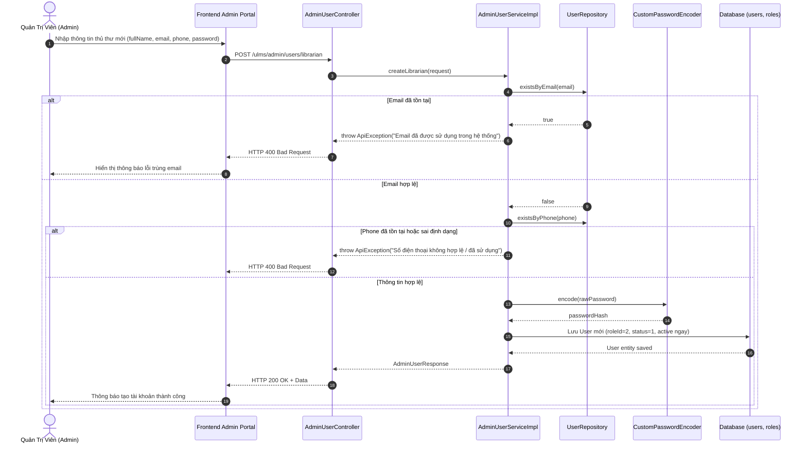
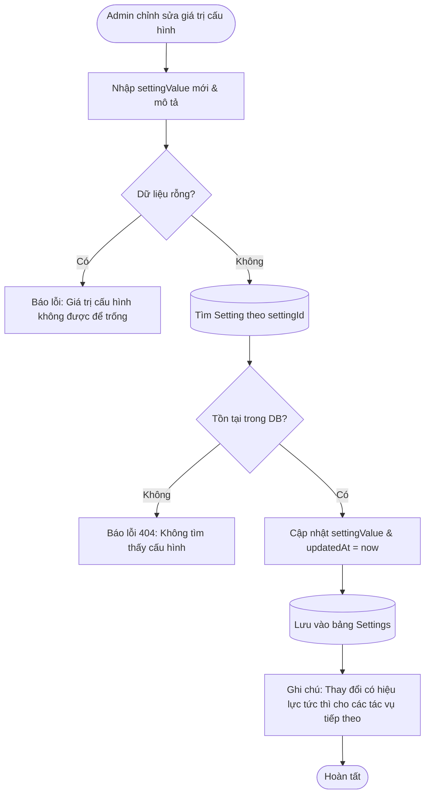
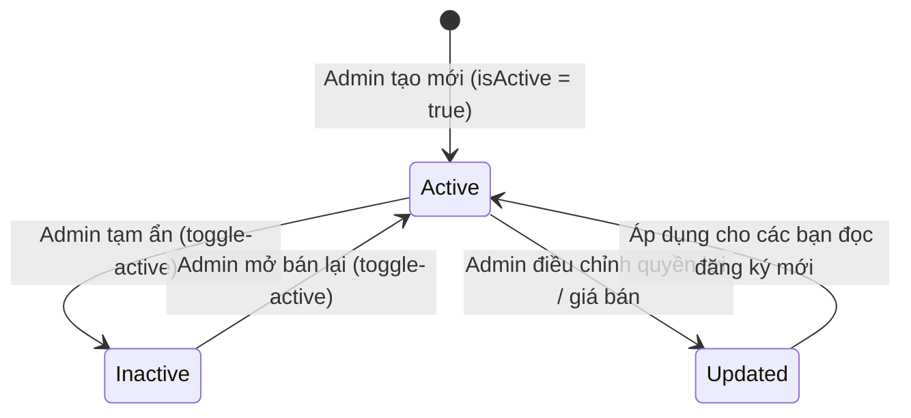
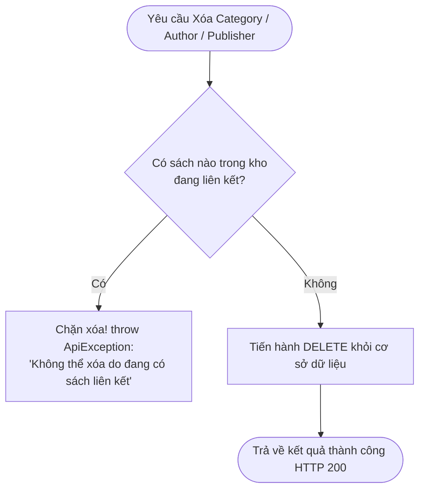
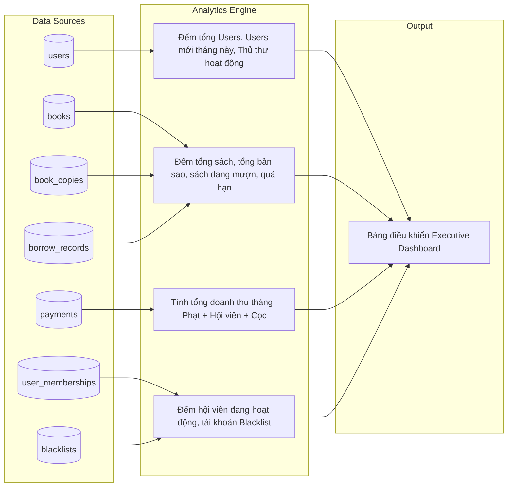
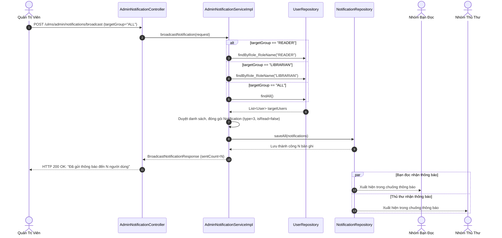

# 🛡️ LUỒNG NGHIỆP VỤ & KIỂM TRA LỖI PHÂN HỆ ADMIN (QUẢN TRỊ VIÊN) - ULMS

> **Phiên bản:** 1.0.0  
> **Cập nhật ngày:** 18/10/2026  
> **Phân hệ:** Quản trị toàn hệ thống (Admin System Management)  
> **Mục tiêu:** Mô tả chi tiết luồng nghiệp vụ, sơ đồ trình tự tương tác, các điểm kiểm tra validation, ngoại lệ và kịch bản test cụ thể.

---

## 📑 MỤC LỤC

1. [Luồng Nghiệp Vụ Nhóm 1: Quản Lý Người Dùng & Phân Quyền](#1-luồng-nghiệp-vụ-nhóm-1-quản-lý-người-dùng--phân-quyền)
2. [Luồng Nghiệp Vụ Nhóm 2: Quản Lý Cấu Hình Hệ Thống](#2-luồng-nghiệp-vụ-nhóm-2-quản-lý-cấu-hình-hệ-thống)
3. [Luồng Nghiệp Vụ Nhóm 3: Quản Lý Gói Hội Viên](#3-luồng-nghiệp-vụ-nhóm-3-quản-lý-gói-hội-viên)
4. [Luồng Nghiệp Vụ Nhóm 4: Quản Lý Danh Mục Dữ Liệu (Master Data)](#4-luồng-nghiệp-vụ-nhóm-4-quản-lý-danh-mục-dữ-liệu-master-data)
5. [Luồng Nghiệp Vụ Nhóm 5: Báo Cáo Doanh Thu & Thống Kê Tổng Hợp](#5-luồng-nghiệp-vụ-nhóm-5-báo-cáo-doanh-thu--thống-kê-tổng-hợp)
6. [Luồng Nghiệp Vụ Nhóm 6: Phát Thông Báo Toàn Hệ Thống](#6-luồng-nghiệp-vụ-nhóm-6-phát-thông-báo-toàn-hệ-thống)
7. [Tổng Hợp Các Kịch Bản Kiểm Thử & Ngoại Lệ (Test Cases & Error Handling)](#7-tổng-hợp-các-kịch-bản-kiểm-thử--ngoại-lệ)

---

## 1. LUỒNG NGHIỆP VỤ NHÓM 1: QUẢN LÝ NGƯỜI DÙNG & PHÂN QUYỀN

### 1.1. Luồng Tạo Mới Tài Khoản Thủ Thư (Librarian Provisioning)

### 1.2. Luồng Khóa / Mở Khóa Tài Khoản Bạn Đọc

1. **Kiểm tra quyền hạn bản thân:**
   * Admin không được phép khóa tài khoản của chính mình (`currentUser.getUserId() == targetUserId`).
   * Không được khóa tài khoản của các Quản trị viên (ADMIN) khác nhằm chống chiếm quyền/đối kháng nội bộ.
2. **Cập nhật trạng thái:**
   * Nếu khóa (`status = 2`): Ghi nhận thời gian cập nhật, đồng thời tạo một bản ghi `Notification` gửi vào hòm thư tài khoản đích với tiêu đề: *"Tài khoản của bạn đã bị khóa"*.
   * Nếu mở khóa (`status = 1`): Phục hồi quyền truy cập bình thường.

---

## 2. LUỒNG NGHIỆP VỤ NHÓM 2: QUẢN LÝ CẤU HÌNH HỆ THỐNG

### 2.1. Chu trình Cập nhật Tham số Cấu hình (System Settings)

* **Điểm quan trọng:**
  * Việc sửa đổi giá trị `FINE_PER_DAY` (ví dụ từ 5.000 lên 7.000 VNĐ) sẽ có hiệu lực ngay trong đợt quét tự động tiếp theo lúc 01:00 AM của `LibrarianFineServiceImpl`. Các khoản phạt đã tạo trước đó vẫn giữ nguyên số tiền đã chốt, không bị ảnh hưởng hồi tố.

---

## 3. LUỒNG NGHIỆP VỤ NHÓM 3: QUẢN LÝ GÓI HỘI VIÊN

### 3.1. Vòng Đời Của Gói Hội Viên (Membership Plan Lifecycle)

* **Quy tắc an toàn nghiệp vụ:**
  * Sửa giá gói hoặc ưu đãi phần trăm cọc **chỉ áp dụng cho các lượt đăng ký mua mới kể từ thời điểm sửa**.
  * Các bạn đọc đang sở hữu gói hội viên còn hạn (`endDate > now`) vẫn được bảo lưu trọn vẹn quyền lợi cho đến hết ngày hiệu lực đã ghi trong `UserMembership`.
  * Không hỗ trợ xóa cứng gói khỏi Database nhằm bảo toàn tính toàn vẹn của lịch sử thanh toán (`payments.plan_id`). Thay vào đó sử dụng tính năng **Bật / Tắt trạng thái hiển thị (`isActive`)**.

---

## 4. LUỒNG NGHIỆP VỤ NHÓM 4: QUẢN LÝ DANH MỤC DỮ LIỆU (MASTER DATA)

### 4.1. Quy tắc Bảo Vệ Dữ Liệu Khi Xóa Master Data (Category, Author, Publisher)

* **Chi tiết bảo vệ:**
  * `bookRepository.existsByCategory_CategoryId(id)`: Chặn xóa nếu còn sách thuộc danh mục.
  * `bookRepository.existsByAuthor_AuthorId(id)`: Chặn xóa tác giả nếu còn sách mang tên tác giả đó.
  * `bookRepository.existsByPublisher_PublisherId(id)`: Chặn xóa NXB nếu còn sách thuộc NXB đó.
  * Khi tạo mới hoặc cập nhật tên: Luôn kiểm tra tính duy nhất (`existsByNameAnd...Not`) để không bị trùng lặp dữ liệu.

---

## 5. LUỒNG NGHIỆP VỤ NHÓM 5: BÁO CÁO DOANH THU & THỐNG KÊ TỔNG HỢP

### 5.1. Thuật Toán Thống Kê Bảng Điều Khiển Quản Trị (Dashboard KPIs)

* **Doanh thu thực tế (Recognized Revenue):**
  * Chỉ tính các giao dịch có `status = 1` (SUCCESS).
  * Phân tách rõ ràng giữa:
    * `fineRevenue`: Doanh thu từ tiền phạt quá hạn / hư hỏng.
    * `membershipRevenue`: Doanh thu thuần từ bán gói dịch vụ hội viên.
    * Tiền đặt cọc mượn sách (`payment_type = 3`) và hoàn cọc (`payment_type = 4`) là dòng tiền luân chuyển ký quỹ, không tính vào doanh thu giữ lại của thư viện.

---

## 6. LUỒNG NGHIỆP VỤ NHÓM 6: PHÁT THÔNG BÁO TOÀN HỆ THỐNG

### 6.1. Quy Trình Broadcast Notification

---

## 7. TỔNG HỢP CÁC KỊCH BẢN KIỂM THỬ & NGOẠI LỆ

| Mã Test | Tên Kịch Bản Kiểm Thử | Dữ Liệu Đầu Vào | Kết Quả Mong Đợi | Trạng Thái Xử Lý |
|---|---|---|---|---|
| **TC-ADM-01** | Tạo thủ thư trùng email đã có | `email: "reader@example.com"` | Báo lỗi: *"Email đã được sử dụng trong hệ thống"* | `throw new ApiException` (HTTP 400) |
| **TC-ADM-02** | Tạo thủ thư với số điện thoại sai định dạng | `phone: "12345"` | Báo lỗi: *"Số điện thoại không hợp lệ..."* | `throw new ApiException` (HTTP 400) |
| **TC-ADM-03** | Admin tự khóa tài khoản của mình | `userId: currentUser.getId()`, `status: 2` | Báo lỗi: *"Không thể tự thay đổi trạng thái tài khoản của chính mình"* | `throw new ApiException` (HTTP 400) |
| **TC-ADM-04** | Admin khóa tài khoản của Admin khác | `targetUser.role: "ADMIN"`, `status: 2` | Báo lỗi: *"Không thể khóa tài khoản của Quản trị viên khác"* | `throw new ApiException` (HTTP 400) |
| **TC-ADM-05** | Nâng quyền user lên Admin qua API đổi vai trò | `roleId: 3` | Báo lỗi: *"Không thể cấp hoặc thay đổi quyền Quản trị viên qua API này"* | `throw new ApiException` (HTTP 400) |
| **TC-ADM-06** | Reset mật khẩu người dùng | `userId: 5` | Sinh ngẫu nhiên mật khẩu tạm (ví dụ `Ulms@4928`), mã hóa BCrypt vào DB, trả về pass cho Admin | Thành công (HTTP 200) |
| **TC-ADM-07** | Tạo cấu hình trùng khóa (Duplicate Key) | `settingKey: "FINE_PER_DAY"` | Báo lỗi: *"Mã cấu hình đã tồn tại trong hệ thống"* | `throw new ApiException` (HTTP 400) |
| **TC-ADM-08** | Cập nhật giá trị cấu hình rỗng | `settingValue: ""` | Báo lỗi: *"Giá trị cấu hình không được để trống"* | `throw new ApiException` (HTTP 400) |
| **TC-ADM-09** | Tạo gói hội viên có giá âm | `price: -50000` | Báo lỗi: *"Giá gói không được nhỏ hơn 0"* | `throw new ApiException` (HTTP 400) |
| **TC-ADM-10** | Tạo gói hội viên có % giảm cọc > 100% | `depositDiscountPct: 150` | Báo lỗi: *"Phần trăm giảm cọc phải từ 0 đến 100"* | `throw new ApiException` (HTTP 400) |
| **TC-ADM-11** | Ẩn gói hội viên đang bán | `PATCH /toggle-active` | `isActive` chuyển thành `false`, gói biến mất khỏi API Reader | Thành công (HTTP 200) |
| **TC-ADM-12** | Xóa thể loại đang có sách trong thư viện | `categoryId: 1` (đang có 10 cuốn sách) | Chặn xóa: *"Không thể xóa thể loại đang có sách liên kết trong hệ thống"* | `throw new ApiException` (HTTP 400) |
| **TC-ADM-13** | Xóa tác giả không có sách nào | `authorId: 99` (chưa có sách liên kết) | Xóa thành công bản ghi khỏi Database | Thành công (HTTP 200) |
| **TC-ADM-14** | Truy vấn Dashboard Quản trị | `GET /dashboard` | Trả về đủ 12 chỉ số KPI (Users, Sách, Mượn, Doanh thu, Hội viên, Blacklist) | Thành công (HTTP 200) |
| **TC-ADM-15** | Báo cáo thanh toán lọc theo ngày & phương thức | `paymentMethod: 2 (VNPAY)`, `status: 1` | Trả về danh sách phân trang các giao dịch VNPay thành công | Thành công (HTTP 200) |
| **TC-ADM-16** | Báo cáo Top sách mượn nhiều nhất | `limit: 5` | Trả về 5 đầu sách có số lượt mượn trong BorrowDetail cao nhất | Thành công (HTTP 200) |
| **TC-ADM-17** | Phát thông báo hàng loạt cho toàn bộ bạn đọc | `targetGroup: "READER"`, `title: "..."` | Hệ thống sinh bản ghi Notification cho tất cả user có role=READER | Thành công (HTTP 200) |
| **TC-ADM-18** | Tra cứu lịch sử thông báo đã phát | `GET /notifications/history` | Trả về danh sách thông báo phân trang, hiển thị trạng thái đã đọc của từng người | Thành công (HTTP 200) |
