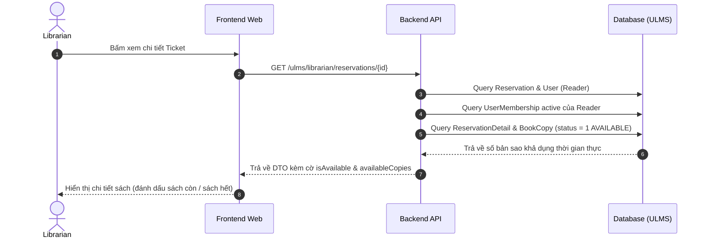
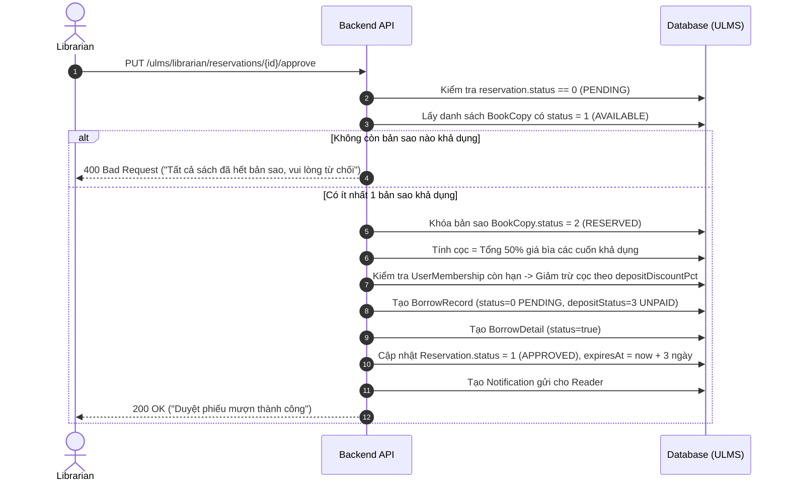
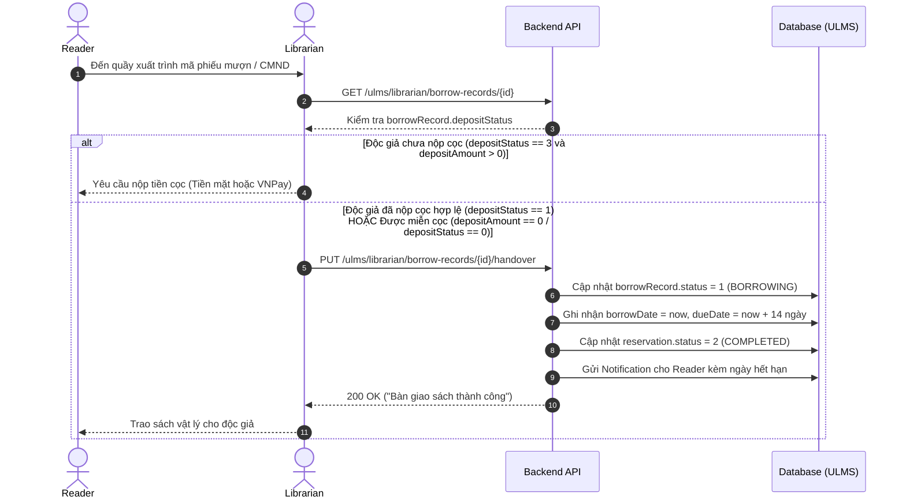
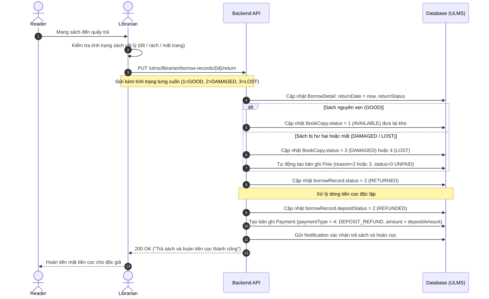
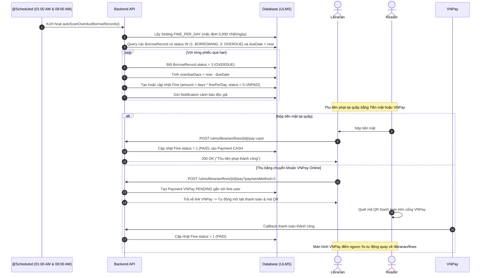
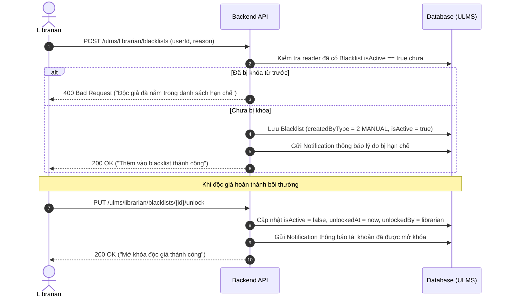
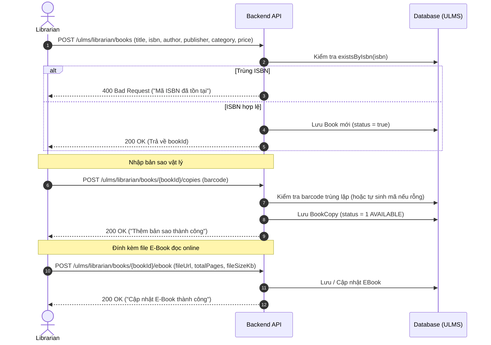

# 🔄 LUỒNG NGHIỆP VỤ & KIỂM TRA LỖI PHÂN HỆ LIBRARIAN (THỦ THƯ) - ULMS

> **Phiên bản:** 1.0.0  
> **Cập nhật ngày:** 18/10/2026  
> **Tài liệu tham chiếu:** [API_DOCUMENTATION_LIBRARIAN.md](file:///d:/Library/API_DOCUMENTATION_LIBRARIAN.md)

---

## 📋 MỤC LỤC

1. [Luồng 1: Xem Chi Tiết Ticket & Kiểm Tra Kho Sách (Pre-Check Availability)](#1-luồng-1-xem-chi-tiết-ticket--kiểm-tra-kho-sách-pre-check-availability)
2. [Luồng 2: Duyệt Phiếu Mượn & Tính Cọc Tự Động (Approve Reservation)](#2-luồng-2-duyệt-phiếu-mượn--tính-cọc-tự-động-approve-reservation)
3. [Luồng 3: Bàn Giao Sách Tại Quầy (Handover Books)](#3-luồng-3-bàn-giao-sách-tại-quầy-handover-books)
4. [Luồng 4: Tiếp Nhận Trả Sách & Hoàn Cọc Độc Lập (Return Books & Refund Deposit)](#4-luồng-4-tiếp-nhận-trả-sách--hoàn-cọc-độc-lập-return-books--refund-deposit)
5. [Luồng 5: Quản Lý Phạt & Quét Quá Hạn Định Kỳ (Fine & Overdue Scanner)](#5-luồng-5-quản-lý-phạt--quét-quá-hạn-định-kỳ-fine--overdue-scanner)
6. [Luồng 6: Quản Lý Danh Sách Hạn Chế (Blacklist Control)](#6-luồng-6-quản-lý-danh-sách-hạn-chế-blacklist-control)
7. [Luồng 7: Quản Lý Kho Sách, Bản Sao & E-Book (Inventory Catalog)](#7-luồng-7-quản-lý-kho-sách-bản-sao--e-book-inventory-catalog)
8. [Bảng Kịch Bản Kiểm Thử Ngoại Lệ Toàn Diện (Edge Cases & Exception Testing)](#8-bảng-kịch-bản-kiểm-thử-ngoại-lệ-toàn-diện-edge-cases--exception-testing)

---

## 1. LUỒNG 1: XEM CHI TIẾT TICKET & KIỂM TRA KHO SÁCH (PRE-CHECK AVAILABILITY)

### Điểm mấu chốt:
- Tại thời điểm reader đặt mượn sách còn, nhưng khi thủ thư duyệt có thể đơn trước đó đã lấy hết. Màn hình chi tiết hiển thị trực tiếp `availableCopies` để thủ thư không bị duyệt nhầm đơn không còn sách.

---

## 2. LUỒNG 2: DUYỆT PHIẾU MƯỢN & TÍNH CỌC TỰ ĐỘNG (APPROVE RESERVATION)

---

## 3. LUỒNG 3: BÀN GIAO SÁCH TẠI QUẦY (HANDOVER BOOKS)

---

## 4. LUỒNG 4: TIẾP NHẬN TRẢ SÁCH & HOÀN CỌC ĐỘC LẬP (RETURN BOOKS & REFUND DEPOSIT)

---

## 5. LUỒNG 5: QUẢN LÝ PHẠT & QUÉT QUÁ HẠN ĐỊNH KỲ (FINE & OVERDUE SCANNER)

---

## 6. LUỒNG 6: QUẢN LÝ DANH SÁCH HẠN CHẾ (BLACKLIST CONTROL)

---

## 7. LUỒNG 7: QUẢN LÝ KHO SÁCH, BẢN SAO & E-BOOK (INVENTORY CATALOG)

---

## 8. BẢNG KỊCH BẢN KIỂM THỬ NGOẠI LỆ TOÀN DIỆN (EDGE CASES & EXCEPTION TESTING)

| STT | Tình huống kiểm thử | Dữ liệu đầu vào | Kết quả mong đợi | Mã lỗi / Trạng thái |
|---|---|---|---|---|
| **1** | Duyệt ticket nhưng tất cả sách trong ticket đều đã hết bản sao | `PUT /reservations/{id}/approve` khi kho không còn bản copy nào có `status=1` | Ném lỗi nghiệp vụ, không tạo `BorrowRecord` rỗng | `400 Bad Request` ("Tất cả sách trong ticket này đều đã hết bản sao khả dụng...") |
| **2** | Duyệt ticket có 3 cuốn sách nhưng 1 cuốn hết bản sao, 2 cuốn còn | Ticket có 3 cuốn, 2 cuốn có copy `status=1` | Tạo `BorrowRecord` cho 2 cuốn còn, tính tiền cọc trên 2 cuốn, cuốn hết bản sao không bị trừ cọc | `200 OK` (Note: "Đã duyệt 2/3 cuốn sách khả dụng") |
| **3** | Duyệt lại một ticket đã được duyệt trước đó | `PUT /reservations/{id}/approve` với `status != 0` | Chặn thao tác duyệt lặp | `400 Bad Request` ("Chỉ có thể duyệt ticket đang ở trạng thái Chờ duyệt") |
| **4** | Tính cọc cho độc giả có gói hội viên giảm 50% | Giá sách 200,000đ, cọc gốc 50% = 100,000đ, gói hội viên giảm 50% cọc | `depositAmount` được tính chính xác là `50,000đ` | `200 OK` (`depositAmount: 50000.00`) |
| **5** | Tính cọc cho độc giả có gói hội viên VIP miễn cọc 100% | Giá sách 300,000đ, cọc gốc 150,000đ, hội viên giảm 100% | `depositAmount` = `0đ` | `200 OK` (`depositAmount: 0.00`) |
| **6** | Bàn giao sách khi độc giả CHƯA nộp cọc | `PUT /borrow-records/{id}/handover` với `depositStatus = 3` và `depositAmount > 0` | Chặn bàn giao sách vật lý | `400 Bad Request` ("Độc giả chưa hoàn tất thanh toán tiền cọc...") |
| **6b** | Bàn giao sách cho Độc giả Premium (Miễn 100% cọc) | `PUT /borrow-records/{id}/handover` với `depositAmount = 0` và `depositStatus = 0` | Cho phép bàn giao ngay, chuyển sang `BORROWING`, không chặn lỗi cọc | `200 OK` |
| **7** | Bàn giao sách khi độc giả ĐÃ nộp cọc hợp lệ | `PUT /borrow-records/{id}/handover` với `depositStatus = 1` (PAID) | Đổi sang `BORROWING`, ghi nhận `dueDate = now + 14 ngày`, reservation sang `COMPLETED` | `200 OK` |
| **8** | Tiếp nhận trả sách nguyên vẹn (GOOD) | `PUT /borrow-records/{id}/return` kèm `returnStatus = 1` | `book_copies.status` quay về `1` (AVAILABLE), `deposit_status` sang `2` (REFUNDED), tạo `Payment` hoàn cọc `type = 4` | `200 OK` |
| **9** | Tiếp nhận trả sách bị hư hỏng (DAMAGED) | `returnStatus = 2`, `fineAmount = 50000` | `book_copies.status` sang `3` (DAMAGED), tự động lập bản ghi `Fine` `amount = 50000`, `status = 0`, tiền cọc vẫn được hoàn trả độc lập | `200 OK` |
| **10** | Quét quá hạn tự động cho phiếu mượn trễ 3 ngày | Phiếu mượn có `dueDate` cách đây 3 ngày, `FINE_PER_DAY = 5000` | Phiếu mượn chuyển `status = 3` (OVERDUE), tạo `Fine` `amount = 15000` (`3 * 5000`), `reason = 1` (OVERDUE) | `200 OK` |
| **11** | Thu tiền phạt bằng tiền mặt tại quầy | `POST /fines/{id}/pay-cash` | `fine.status` chuyển sang `1` (PAID), tạo bản ghi `Payment` `type = 1` (FINE), `method = 1` (CASH), `status = 1` | `200 OK` |
| **11b** | Thu tiền phạt bằng VNPay online | `POST /fines/{id}/pay?paymentMethod=2` | Tạo link VNPay thành công, mở cổng thanh toán tab mới, đếm ngược 5s tự về `/librarian/fines` | `200 OK` |
| **12** | Thu tiền phạt cho khoản phạt ĐÃ được trả trước đó | `POST /fines/{id}/pay-cash` với `fine.status = 1` | Chặn thu tiền 2 lần cho cùng một khoản nợ | `400 Bad Request` ("Khoản phạt này đã được thanh toán trước đó") |
| **13** | Miễn giảm khoản phạt theo thẩm quyền thủ thư | `PUT /fines/{id}/waive` kèm lý do | `fine.status` chuyển sang `2` (WAIVED), lưu lý do miễn giảm | `200 OK` |
| **14** | Thêm độc giả đã bị Blacklist vào Blacklist lần nữa | `POST /blacklists` với reader đã có `isActive = true` | Chặn trùng lặp hồ sơ phạt | `400 Bad Request` ("Độc giả này hiện đã nằm trong danh sách hạn chế mượn sách") |
| **15** | Mở khóa độc giả khỏi Blacklist | `PUT /blacklists/{id}/unlock` | `isActive = false`, ghi nhận `unlockedAt` và `unlockedBy` là thủ thư đang đăng nhập | `200 OK` |
| **16** | Thêm sách mới với ISBN đã tồn tại trong hệ thống | `POST /books` với ISBN trùng | Báo lỗi trùng mã ISBN | `400 Bad Request` ("Mã ISBN '...' đã tồn tại trong hệ thống") |
| **17** | Thêm bản sao không truyền barcode | `POST /books/{id}/copies` không gửi barcode | Tự động sinh barcode duy nhất dạng `BC{bookId}_{timestamp}` và gán `status = 1` | `200 OK` |
| **18** | Đổi trạng thái bản sao sách sang DAMAGED hoặc LOST | `PUT /copies/{id}/status` với `status = 3` hoặc `4` | Cập nhật kho, sách không còn xuất hiện trong danh sách khả dụng cho mượn | `200 OK` |
| **19** | Tra cứu Dashboard tổng quan | `GET /dashboard` | Trả về đầy đủ 9 chỉ số thời gian thực (ticket chờ duyệt, sách đang mượn, trễ hạn, nợ phạt, blacklist, tổng sách, tổng bản sao) | `200 OK` |
| **20** | Phân quyền truy cập tài nguyên thủ thư | Người dùng chưa đăng nhập hoặc role không phải LIBRARIAN/ADMIN gọi `/ulms/librarian/**` | Bị chặn bởi Security Middleware / SecurityUtil | `401 Unauthorized` / `403 Forbidden` |
