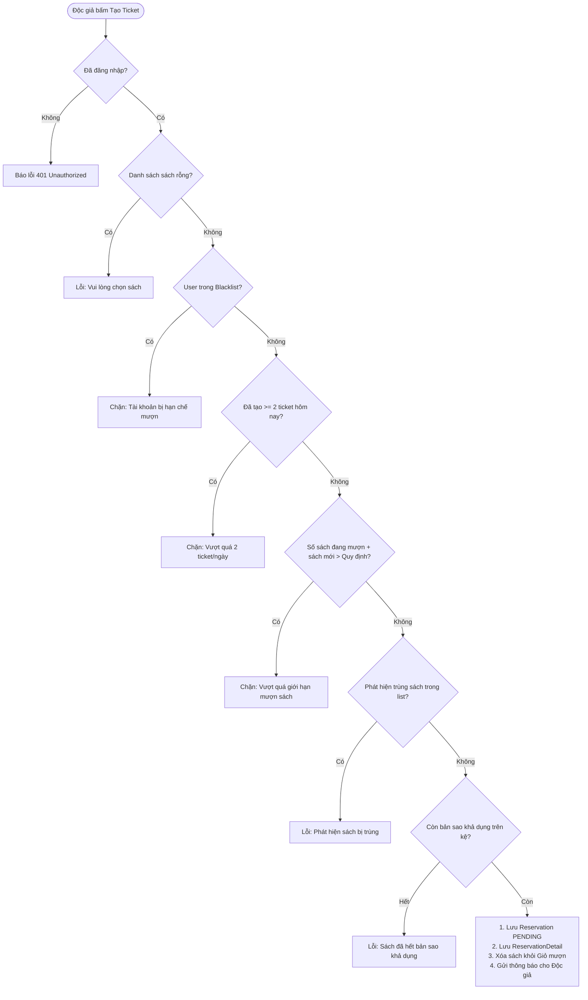
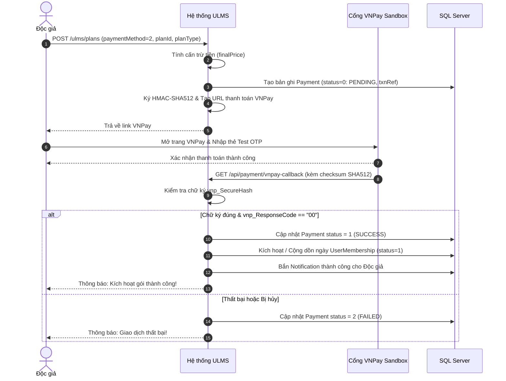
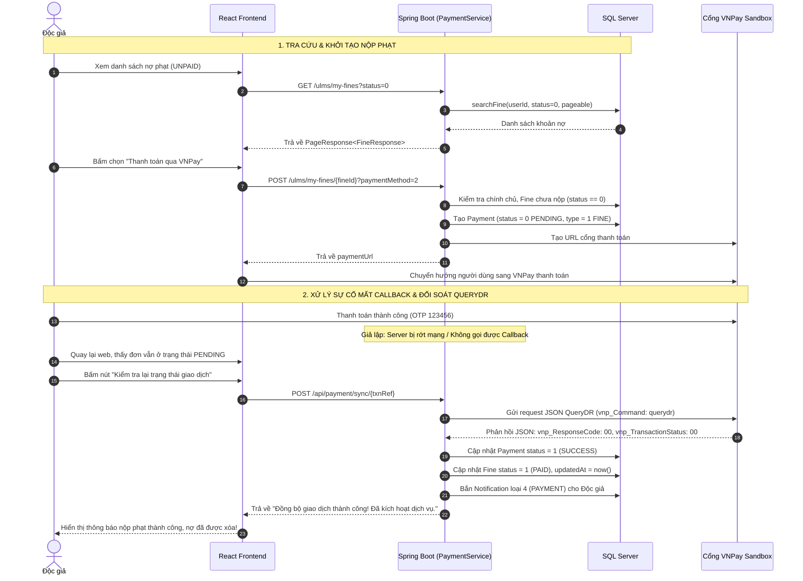
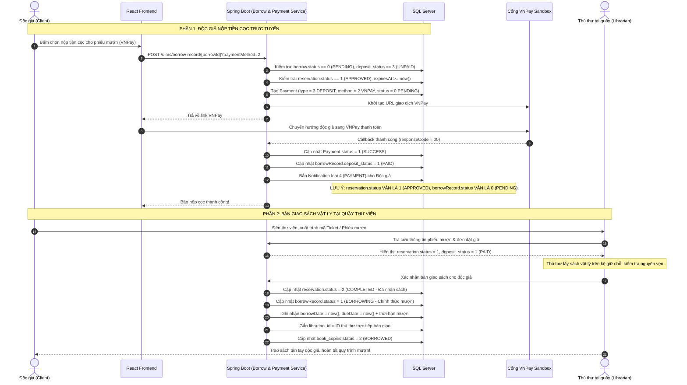
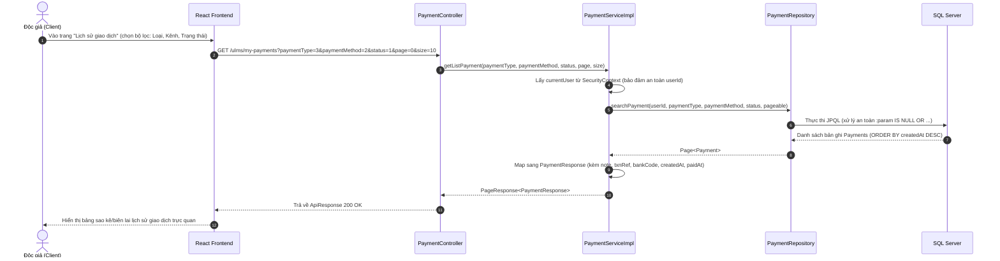
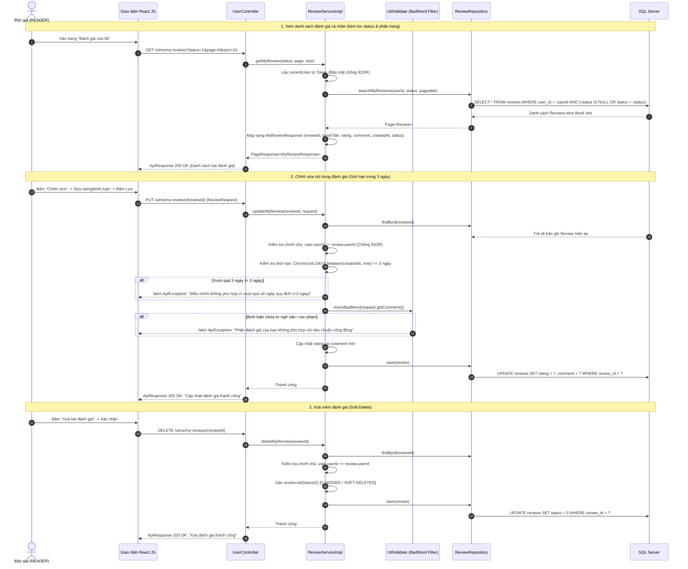
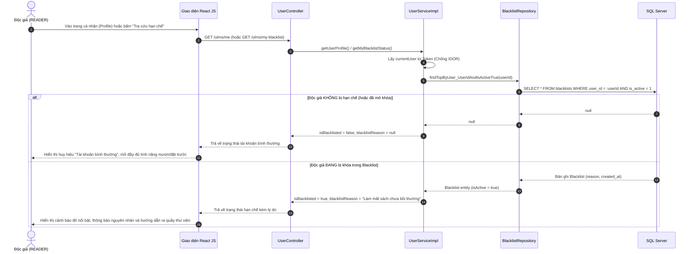
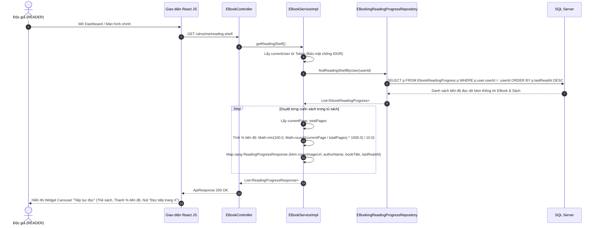

# BÁO CÁO CÁC LUỒNG NGHIỆP VỤ & CƠ CHẾ KIỂM TRA LỖI [PHÂN HỆ GUEST & READER]
## DỰ ÁN: HỆ THỐNG QUẢN LÝ THƯ VIỆN ĐẠI HỌC (ULMS)
> **Tài liệu phục vụ:** Thuyết trình báo cáo đồ án môn học & Tài liệu nghiệp vụ Backend  
> **Phân hệ:** Độc giả (READER) & Khách vãng lai (GUEST)  
> **Công nghệ áp dụng:** Spring Boot 3, Spring Security, JWT, SQL Server, VNPay Sandbox, Cloudinary, BCrypt.

---

## TỔNG QUAN HỆ THỐNG CÁC LUỒNG CHÍNH

Hệ thống ULMS ở giai đoạn hiện tại bao gồm **18 luồng nghiệp vụ cốt lõi** phục vụ cho **GUEST (Khách vãng lai)** và **READER (Độc giả đã đăng nhập)**:

1. **Luồng 1:** Đăng ký tài khoản & Kích hoạt qua mã OTP Email.
2. **Luồng 2:** Quên mật khẩu & Đặt lại mật khẩu bằng OTP Email.
3. **Luồng 3:** Đăng nhập (Local / Google OAuth2) & Cơ chế xác thực phân quyền JWT.
4. **Luồng 4:** Quản lý hồ sơ cá nhân & Tải ảnh đại diện Cloudinary.
5. **Luồng 5:** Tra cứu, lọc sách nâng cao & Xem chi tiết thông tin sách.
6. **Luồng 6:** Quản lý giỏ mượn sách (Borrow Cart).
7. **Luồng 7:** Tạo phiếu đặt giữ sách (Reservation Ticket) & Tự động quét hủy quá hạn.
8. **Luồng 8:** Theo dõi lịch sử mượn trả sách thực tế (Borrow Records) & Chống IDOR.
9. **Luồng 9:** Đăng ký gói hội viên, cấn trừ tiền nâng cấp & Thanh toán VNPay.
10. **Luồng 10:** Đọc sách điện tử E-Book bảo mật & Ghi nhớ tiến độ đọc.
11. **Luồng 11:** Quản lý thông báo cá nhân & Chống lộ thông tin chéo.
12. **Luồng 12:** Quản lý tiền phạt, nộp phạt đa kênh & Đối soát tự động VNPay (QueryDR).
13. **Luồng 13:** Đánh giá sách sau khi hoàn tất trả sách & Bộ lọc kiểm duyệt từ ngữ xấu (Content Moderation).
14. **Luồng 14:** Thanh toán tiền đặt cọc mượn sách (Deposit Payment) & Quy trình bàn giao sách tại quầy.
15. **Luồng 15:** Tra cứu lịch sử giao dịch & Biên lai tài chính cá nhân (My Payments).
16. **Luồng 16:** Quản lý đánh giá cá nhân (My Reviews - Xem danh sách, chỉnh sửa trong 3 ngày, xoá mềm lưu vết).
17. **Luồng 17:** Tra cứu trạng thái danh sách hạn chế (My Blacklist Status - Minh bạch lý do vi phạm).
18. **Luồng 18:** Tủ sách cá nhân & "Tiếp tục đọc E-Book" (Continue Reading Shelf - Widget Dashboard 1 chạm).

---

# CHI TIẾT TỪNG LUỒNG NGHIỆP VỤ & CƠ CHẾ CHECK LỖI

---

## LUỒNG 1: ĐĂNG KÝ TÀI KHOẢN & KÍCH HOẠT QUA OTP EMAIL

### 1. Mục đích & Đối tượng
- **Đối tượng:** `GUEST` (Người dùng chưa có tài khoản).
- **Mục đích:** Cho phép sinh viên/độc giả đăng ký tài khoản mới bằng email trường học/cá nhân và xác minh tính chính chủ của email trước khi được phép đăng nhập.

### 2. Quy trình hoạt động (Step-by-step)
1. Khách điền form đăng ký gồm: Họ tên, Email, Mật khẩu, Số điện thoại, Địa chỉ.
2. Client gửi request `POST /ulms/auth/register`.
3. Backend tiến hành chuẩn hóa dữ liệu (cắt khoảng trắng thừa) và chạy các tầng kiểm tra hợp lệ.
4. Nếu hợp lệ:
   - Mật khẩu được mã hóa an toàn qua thuật toán **BCrypt**.
   - Lưu bản ghi vào bảng `users` với `role_id = 1` (READER) và `status = 0` (PENDING_VERIFICATION - Chờ kích hoạt).
   - Backend sinh mã OTP ngẫu nhiên gồm 6 chữ số, mã hóa hash OTP lưu vào bảng `user_tokens` với thời hạn hiệu lực **5 phút**, cờ `used = false`, `token_type = 0` (EMAIL_VERIFY).
   - Hệ thống kích hoạt dịch vụ Email gửi OTP nguyên bản tới hòm thư của người dùng.
5. Người dùng nhận email, nhập mã OTP vào trang xác thực (`POST /ulms/auth/verify-email`).
6. Backend kiểm tra mã OTP, nếu khớp sẽ chuyển `user.status = 1` (ACTIVE) và đánh dấu `used = true`. Tài khoản chính thức kích hoạt.

### 3. Cơ chế kiểm tra, Validate & Check lỗi (Validations)
- **Họ và tên:** Kiểm tra Regex `^[a-zA-ZÀ-ỹ\\s'-]{2,100}$` (độ dài 2–100 ký tự, có dấu tiếng Việt, **không chứa số**, không chứa ký tự đặc biệt lạ).
- **Email:** Kiểm tra Regex chuẩn RFC email; kiểm tra `userRepository.existsByEmail(email)` (báo lỗi ngay nếu email đã có người dùng).
- **Số điện thoại:** Kiểm tra đúng **10 chữ số** và bắt buộc **bắt đầu bằng số 0** (`^0[0-9]{9}$`); kiểm tra `existsByPhone(phone)` chống trùng lặp.
- **Độ phức tạp mật khẩu:** Bắt buộc tối thiểu **8 ký tự**, có ít nhất 1 chữ hoa, 1 chữ thường, 1 chữ số và 1 ký tự đặc biệt (`@, $, !, %, *, ?, &`).
- **Khi nhập mã OTP để kích hoạt (`verifyEmail`):**
  - Check tài khoản có tồn tại không.
  - Check `user.status == 0` (nếu tài khoản đã kích hoạt trước đó thì chặn ngay, thông báo "Tài khoản đã xác thực").
  - Check loại token: `tokenType` bắt buộc là `false` (0: Kích hoạt tài khoản, chặn việc dùng nhầm OTP reset password).
  - Check so khớp mã OTP: So khớp OTP gửi lên với `tokenHash` trong DB qua `customPasswordEncoder.matches()`.
  - Check hạn sử dụng OTP: So sánh `expiresAt.isBefore(now)` (quá 5 phút báo "OTP hết hạn").
  - Check sử dụng lại: `userToken.getUsed() == true` (báo "OTP đã được sử dụng").

### 4. Điểm nhấn thuyết trình:
> *"Hệ thống không lưu OTP dạng văn bản thuần trong database mà mã hóa hash bằng BCrypt, đồng thời áp dụng cơ chế tự hủy token sau 5 phút và chống replay attack bằng cờ `used`, đảm bảo an toàn tối đa cho thông tin đăng ký."*

---

## LUỒNG 2: QUÊN MẬT KHẨU & ĐẶT LẠI MẬT KHẨU BẰNG OTP

### 1. Mục đích & Đối tượng
- **Đối tượng:** `GUEST / READER`.
- **Mục đích:** Giúp người dùng khôi phục mật khẩu khi quên mà không cần can thiệp thủ công từ quản trị viên.

### 2. Quy trình hoạt động
1. Người dùng nhập email yêu cầu cấp lại mật khẩu (`POST /ulms/auth/resend-OTP-verify` với `tokenType = true`).
2. Backend kiểm tra: Tài khoản phải tồn tại và đang ở trạng thái `status = 1` (ACTIVE).
3. Backend sinh OTP 6 số mới, hash và lưu vào bảng `user_tokens` (hạn 5 phút), gửi về email.
4. Người dùng nhập OTP + Mật khẩu mới vào form (`POST /ulms/auth/reset-password`).
5. Backend xác thực OTP, kiểm tra độ an toàn của mật khẩu mới, băm BCrypt cập nhật vào `users.password_hash`, đánh dấu token đã sử dụng.

### 3. Cơ chế kiểm tra & Check lỗi
- **Kiểm tra trạng thái tài khoản:** Nếu tài khoản đang ở `status = 0` (chưa kích hoạt) hoặc `status = 2` (bị khóa) -> Chặn, không cho gửi OTP đổi mật khẩu.
- **Ràng buộc loại Token:** Kiểm tra `tokenType == true` (1: PASSWORD_RESET), tránh lấy mã OTP xác thực email đem sang đặt lại mật khẩu.
- **Kiểm tra mật khẩu mới:** Chạy đầy đủ Regex mật khẩu mạnh trước khi ghi đè vào DB.

---

## LUỒNG 3: ĐĂNG NHẬP & PHÂN QUYỀN TRUY CẬP JWT

### 1. Mục đích & Đối tượng
- **Đối tượng:** `GUEST`.
- **Mục đích:** Cấp phát Access Token (JWT) định danh người dùng sau khi đăng nhập thành công qua tài khoản cục bộ hoặc Google OAuth2.

### 2. Quy trình hoạt động

```mermaid
sequenceDiagram
    autonumber
    actor User as Độc giả (Client)
    participant Auth as AuthController
    participant Svc as AuthServiceImpl
    participant Google as Google Token Verifier
    participant DB as SQL Server
    participant JWT as JwtService

    alt Đăng nhập Cục bộ
        User->>Auth: POST /ulms/auth/login (email, password)
        Auth->>Svc: login(request)
        Svc->>DB: findByEmail(email)
        Svc->>Svc: Kiểm tra trạng thái & So khớp BCrypt
    else Đăng nhập Google
        User->>Auth: POST /ulms/auth/google (idToken)
        Auth->>Svc: loginWithGoogle(request)
        Svc->>Google: verify(idTokenString)
        Google-->>Svc: Trả về email, sub, name, avatar
        Svc->>DB: Kiểm tra bảng user_auth & users (tạo mới nếu chưa có)
    end
    Svc->>DB: Cập nhật last_login_at
    Svc->>JWT: generateToken(userId, email, roleName)
    JWT-->>Svc: Access Token (24h)
    Svc-->>Auth-->>User: 200 OK + Token & Thông tin User
```

### 3. Cơ chế kiểm tra & Check lỗi
- **Kiểm tra trạng thái người dùng (Account Status):**
  - `status == 0`: Báo lỗi *"Tài khoản chưa được kích hoạt. Vui lòng xác thực email"*.
  - `status == 2`: Báo lỗi *"Tài khoản đã bị khóa. Vui lòng liên hệ quản trị viên"*.
  - `status == 3`: Báo lỗi *"Tài khoản hiện đang ngưng hoạt động"*.
- **So khớp mật khẩu:** Dùng `customPasswordEncoder.matches(raw, hash)`. Nếu sai, thông báo chung *"Email hoặc mật khẩu không chính xác"* để bảo mật, tránh làm lộ việc email có tồn tại hay không.
- **Xác thực Google ID Token:** Sử dụng thư viện chính thức `GoogleIdTokenVerifier` với Client ID của Google, tự động xác minh chữ ký mã token từ server Google; nếu token giả mạo hoặc hết hạn sẽ ném lỗi ngay.
- **Filter bảo mật `JwtAuthenticationFilter`:**
  - Chặn và giải mã header `Authorization: Bearer <token>`.
  - Kiểm tra tính hợp lệ và thời hạn của token.
  - Nạp thông tin quyền `ROLE_READER` vào `SecurityContextHolder`.

---

## LUỒNG 4: QUẢN LÝ HỒ SƠ & TẢI ẢNH ĐẠI DIỆN CLOUDINARY

### 1. Mục đích & Đối tượng
- **Đối tượng:** `READER`.
- **Mục đích:** Xem thông tin cá nhân, cập nhật địa chỉ/SĐT, đổi mật khẩu và upload avatar trực tiếp lên Cloudinary.

### 2. Quy trình & Cơ chế Check lỗi
- **Xác thực phiên làm việc:** `securityUtil.getCurrentUser()` lấy thông tin từ JWT Token. Nếu chưa đăng nhập hoặc token giả -> Ném lỗi `401 Unauthorized` ngay lập tức.
- **Chống can thiệp chéo ID người dùng (`utilValidate.checkCurrentUser`):**
  - Khi gửi request cập nhật hồ sơ hoặc đổi mật khẩu, hệ thống đối chiếu `request.getUserId()` với `securityUtil.getCurrentUserId()`. Nếu độc giả cố tình sửa `userId` trong body sang người khác -> Chặn ngay.
- **Kiểm tra đổi số điện thoại & An toàn cho tài khoản Email:**
  - Nếu tài khoản tạo qua Email/Google (ban đầu `phone == null`), hệ thống kiểm tra null-safety tránh lỗi `NullPointerException` khi cập nhật hồ sơ lần đầu.
  - Kiểm tra định dạng đúng 10 chữ số bắt đầu bằng số 0 và check `userRepository.existsByPhone(newPhone)`.
- **Validation chặt chẽ trên giao diện Frontend:**
  - Ô số điện thoại chỉ cho phép nhập chữ số (tự động loại bỏ chữ cái và ký tự đặc biệt).
  - Họ tên kiểm tra Regex hỗ trợ đầy đủ bộ ký tự tiếng Việt Unicode (bao gồm cả `Đ` và `đ`), từ 2-100 ký tự và không chứa số.
  - Địa chỉ yêu cầu tối thiểu 5 ký tự để đảm bảo thông tin liên lạc giao nhận sách.
  - Mật khẩu mới bắt buộc tối thiểu 8 ký tự, có ít nhất 1 chữ hoa, 1 chữ thường, 1 số và 1 ký tự đặc biệt. Hiển thị thông báo lỗi màu đỏ trực tiếp dưới từng ô nhập liệu.
- **Kiểm tra đổi mật khẩu:**
  - Bắt buộc kiểm tra mật khẩu hiện tại `matches(currentPassword, user.getPasswordHash())`.
  - Mật khẩu mới và mật khẩu xác nhận phải trùng nhau (`newPassword.equals(confirmPassword)`).
  - Mật khẩu mới phải đạt chuẩn bảo mật Regex.
- **Upload Avatar:** Tiếp nhận `MultipartFile`, gửi qua `CloudinaryService` đẩy lên Cloudinary, lưu đường dẫn CDN an toàn (`secure_url`) vào database.

---

## LUỒNG 5: TRA CỨU, TÌM KIẾM SÁCH & BỘ LỌC ĐA TIÊU CHÍ

### 1. Mục đích & Đối tượng
- **Đối tượng:** `GUEST / READER`.
- **Mục đích:** Giúp người đọc dễ dàng tìm thấy đầu sách mong muốn theo nhiều tiêu chí lọc kết hợp.

### 2. Quy trình hoạt động
1. Client gửi request:
   - Danh sách thể loại: `GET /ulms/categories`
   - Danh sách NXB: `GET /ulms/publishers`
   - Tìm kiếm: `GET /ulms/search` kèm các tham số: `keyword`, `categoryId`, `authorId`, `publisherId`, `fromYear`, `toYear`, `minPrice`, `maxPrice`, `page`, `size`.
2. Backend build câu lệnh động thông qua `bookRepository.searchBooks(...)` và phân trang `Pageable`.
3. Chuẩn hóa dữ liệu trả về `PageResponse<BookListResponse>` (gồm danh sách kết quả, số trang, tổng số bản ghi).

### 3. Cơ chế kiểm tra dữ liệu ở chi tiết sách (`getBookDetail`)
- Kiểm tra sách tồn tại và đang ở trạng thái kinh doanh (`status == true`).
- Kiểm tra số bản sao thực tế (`BookCopyRepository`):
  - Tính `totalCopies`: Tổng số cuốn sách thư viện sở hữu.
  - Tính `availableCopies`: Số cuốn sách đang có sẵn trên kệ (`status == 1: AVAILABLE`).
  - Đánh giá khả năng mượn: `isAvailable = availableCopies > 0`.
- Kiểm tra phiên bản số: Tự động truy vấn bảng `e_books` để gán cờ `hasEbook` và số trang `ebookTotalPages`.
- Tính điểm uy tín: Gọi `reviewRepository.getAverageRating(bookId)` để tính điểm sao trung bình (1.0 - 5.0).
- Lấy gợi ý sách cùng tác giả: Tự động load danh sách sách liên quan của tác giả đó.

---

## LUỒNG 6: QUẢN LÝ GIỎ MƯỢN SÁCH (BORROW CART)

### 1. Mục đích & Đối tượng
- **Đối tượng:** `READER`.
- **Mục đích:** Cho phép độc giả gom các cuốn sách muốn mượn vào giỏ trước khi tạo yêu cầu mượn chính thức.

### 2. Quy trình hoạt động & Cơ chế Check lỗi
1. **Thêm vào giỏ (`POST /ulms/add-to-cart`):**
   - Check `utilValidate.checkCurrentUser(userId)`: Đảm bảo độc giả chỉ thêm sách vào giỏ của chính mình.
   - Check sách tồn tại & trạng thái `status == true`.
   - Check thư viện có sở hữu bản sao nào không: `bookCopyRepository.countByBookId(bookId) >= 1`.
   - **Chống trùng lặp:** Check `borrowCartRepository.existsByBook_BookIdAndUser_UserId(bookId, userId)`. Nếu sách đã có trong giỏ -> Báo lỗi *"Sách này đã được thêm trước đó"*.
2. **Xem giỏ mượn (`GET /ulms/add-to-cart`):**
   - Lấy toàn bộ sách trong giỏ của độc giả.
   - **Tính toán trạng thái khả dụng theo thời gian thực:** Kiểm tra `countByBookIdAndStatus(bookId, 1) > 0` để thông báo cho độc giả biết cuốn sách đó tại thời điểm này trên kệ còn sách hay đã bị người khác mượn hết.
3. **Xóa khỏi giỏ (`DELETE /ulms/add-to-cart/{cartId}`):**
   - Check `borrowCartRepository.findByCartIdAndUser_UserId(...)`: Đảm bảo chỉ chủ nhân của giỏ mới có quyền xóa.

---

## LUỒNG 7: TẠO PHIẾU ĐẶT GIỮ SÁCH (RESERVATION) & QUÉT HỦY TỰ ĐỘNG

### 1. Mục đích & Đối tượng
- **Đối tượng:** `READER`.
- **Mục đích:** Độc giả gửi yêu cầu giữ sách trước để thủ thư xếp sách trên kệ sẵn, tránh việc đến thư viện nhưng sách đã bị người khác mượn mất.

### 2. Quy trình tạo phiếu & Các tầng Check lỗi nghiêm ngặt (Business Rules)



### 3. Cơ chế tự động hủy phiếu quá hạn (Scheduled Background Cron)
- **Cơ chế:** Hàm `autoCancelReservationExpired()` được cấu hình `@Scheduled(fixedDelay = 60_000)` chạy nền tự động mỗi **60 giây**.
- **Điều kiện kích hoạt:** Quét các phiếu mượn có `status = 1` (APPROVED - Đã được thủ thư duyệt giữ sách) và `expires_at < LocalDateTime.now()` (quá 3 ngày độc giả không đến thư viện nhận sách).
- **Hành động xử lý:**
  1. Chuyển `Reservation.status = 5` (EXPIRED).
  2. Tìm phiếu mượn tương ứng `BorrowRecord`, chuyển `status = 4` (CANCELLED).
  3. **Tự động hoàn trả bản sao:** Đưa các cuốn sách vật lý `BookCopy` từ trạng thái bị giữ về lại `status = 1` (AVAILABLE) để độc giả khác có thể mượn.
  4. Gửi thông báo hủy ticket do quá hạn đến tài khoản độc giả.

### 4. Hiển thị đầy đủ trạng thái Ticket & Điều hướng Lịch sử mượn trả
- **Hệ thống tab trạng thái đầy đủ:** Giao diện Reader (`/reservations`) hiển thị đầy đủ 6 trạng thái: `0: Chờ duyệt`, `1: Đã duyệt (Giữ chỗ)`, `2: Đã nhận sách`, `3: Đã huỷ`, `4: Bị từ chối`, `5: Hết hạn giữ chỗ`.
- **Liên kết sang Lịch sử mượn trả:** Trong modal chi tiết Ticket đã duyệt, độc giả có thể click trực tiếp vào nút *"Lịch sử mượn trả"* để chuyển hướng sang route chính xác `/borrow-records` (không bị lỗi 404).

### 5. Độc giả chủ động hủy phiếu (`cancelReservation`)
- Chỉ cho phép hủy khi phiếu đang ở trạng thái `0` (PENDING) hoặc `1` (APPROVED).
- Nếu phiếu đã được duyệt (`status = 1`): Hệ thống tự động giải phóng bản sao sách về kệ và hủy phiếu mượn liên quan.
- Chuyển `Reservation.status = 3` (CANCELLED) và lưu lịch sử thông báo.

---

## LUỒNG 8: THEO DÕI LỊCH SỬ MƯỢN TRẢ SÁCH THỰC TẾ (BORROW RECORDS)

### 1. Mục đích & Đối tượng
- **Đối tượng:** `READER`.
- **Mục đích:** Cho phép độc giả theo dõi các cuốn sách vật lý mình đang cầm ngoài đời thực, ngày hết hạn trả sách (`dueDate`), tiền cọc đã đóng, số lần gia hạn và lịch sử các cuốn sách đã trả.

### 2. Quy trình hoạt động
1. **Xem danh sách phiếu mượn (`GET /ulms/borrow-record`):**
   - Độc giả xem danh sách phiếu mượn được sắp xếp theo thời gian mới nhất (`createdAt DESC`), có thể lọc theo `status` (Đang mượn, Đã trả, Quá hạn...).
   - Backend lấy `userId` trực tiếp từ JWT Token của người đang đăng nhập, gọi `borrowRecordRepository.getBorrowRecord(userId, status, pageable)`.
2. **Xem chi tiết phiếu mượn (`GET /ulms/borrow-record/{id}`):**
   - Backend truy vấn bản ghi `BorrowRecord` và kiểm tra quyền sở hữu (chống IDOR).
   - Truy vấn chi tiết các cuốn sách trong phiếu (`BorrowDetail`), kết nối với `BookCopy` và `Book` để trả về đầy đủ: Tên sách (`bookTitle`), Ảnh bìa (`coverImageUrl`), Tác giả (`authorName`), Mã vạch (`barcode`), Ngày trả thực tế và Tình trạng sách khi trả.
3. **Xin gia hạn mượn sách trực tuyến (`PUT /ulms/borrow-record/{id}/extend`):**
   - Độc giả bấm nút "Gia hạn thêm 7 ngày" ngay trên màn hình chi tiết phiếu mượn.
   - Backend áp dụng mô hình kiểm tra nghiêm ngặt 4 tầng (Fail-Fast) trước khi đồng ý cộng thêm 7 ngày vào `dueDate`.

### 3. Cơ chế kiểm tra, Check lỗi & Bảo mật
- **Bảo mật chống truy cập trái phép (IDOR Prevention):**
  ```java
  if (!br.getUser().getUserId().equals(user.getUserId())) {
      throw new ApiException("Bạn không có quyền truy cập/thao tác trên phiếu mượn này");
  }
  ```
  Chặn đứng việc người dùng A xem trộm lịch sử hoặc gia hạn phiếu mượn của người dùng B.
- **Quy tắc 5 điều kiện "Vàng" khi gia hạn sách:**
  1. *Phiếu phải tồn tại và đang ở trạng thái mượn:* `status == 1 (BORROWING)`. Đã trả (`2`) hoặc bị hủy (`4`) không được gia hạn.
  2. *Chưa quá hạn:* `now <= dueDate`. Nếu đã quá hạn (`status == 3 OVERDUE`) thì bắt buộc mang sách đến quầy nộp phạt, không được gia hạn.
  3. *Số lần gia hạn:* `extensionCount == 0` (Mỗi phiếu chỉ được gia hạn tối đa **1 lần**, tránh tình trạng độc quyền sách).
  4. *Tài khoản không bị Blacklist:* `Blacklist` không có hiệu lực đối với độc giả.
  5. *Không nợ tiền phạt:* Độc giả không có khoản tiền phạt nào chưa thanh toán (`fines.status == 0 UNPAID`).
- **Thực hiện gia hạn:** Khi thỏa mãn, tăng `extensionCount = 1`, cộng thêm 7 ngày `dueDate = dueDate.plusDays(7)` và lưu xuống CSDL.
- **Null-Safety cho Thủ thư:** Kiểm tra `br.getLibrarian() != null` trước khi lấy ID và Tên thủ thư, tránh lỗi `NullPointerException` nếu dữ liệu ban đầu thiếu thủ thư phụ trách.
- **Đổ dữ liệu Entity an toàn:** Do `BookCopy` lưu `bookId` trực tiếp, service truy vấn `bookRepository.findById(bookId)` để lấy metadata sách đầy đủ hiển thị cho Frontend.

---

## LUỒNG 9: GÓI HỘI VIÊN, CẤN TRỪ TIỀN NÂNG CẤP & THANH TOÁN VNPAY

### 1. Mục đích & Đối tượng
- **Đối tượng:** `READER`.
- **Mục đích:** Cho phép độc giả đăng ký thẻ hội viên để hưởng đặc quyền: đọc E-Book và miễn/giảm tiền cọc sách vật lý; hỗ trợ thanh toán qua cổng VNPay Sandbox.

### 2. Thuật toán cấn trừ tiền khi Nâng Cấp Gói (Key Feature Thuyết Trình)
Khi độc giả đang có gói hội viên còn hạn nhưng muốn nâng cấp lên gói cao hơn (`planType = false: UPGRADE`):
1. Tính số ngày còn lại của gói cũ:  
   $$\text{dayRemain} = \text{endDate} - \text{today}$$
2. Tính đơn giá giá trị mỗi ngày của gói cũ:  
   $$\text{dailyRate} = \frac{\text{oldPlanPrice}}{\text{durationDays}}$$ *(Làm tròn 2 chữ số thập phân)*
3. Tính số tiền thừa của gói cũ chưa dùng hết:  
   $$\text{moneyRemain} = \text{dailyRate} \times \text{dayRemain}$$
4. **Số tiền thực tế độc giả phải thanh toán:**  
   $$\text{finalPrice} = \max(0, \; \text{newPlanPrice} - \text{moneyRemain})$$

### 2.1. Loại bỏ thanh toán tiền mặt cho Gói hội viên (Chỉ Online qua VNPay)
- Theo yêu cầu nghiệp vụ chuẩn hóa số hóa thư viện, giao diện Reader loại bỏ hoàn toàn tùy chọn thanh toán tiền mặt tại quầy đối với gói Membership.
- Mọi giao dịch đăng ký mới hoặc gia hạn gói hội viên đều được thực hiện trực tuyến và kích hoạt tức thì qua cổng VNPay Sandbox.

### 2.2. Giao diện Callback độc lập & Tự động điều hướng sau 5 giây
- Khi VNPay chuyển hướng người dùng về hệ thống (`/payment/callback`), hệ thống ẩn toàn bộ thanh Navbar trên, Footer dưới và Chat Widget để tạo màn hình thông báo độc lập, tập trung.
- Hiển thị thông tin biên lai điện tử và kích hoạt đồng hồ đếm ngược 5 giây kèm thanh tiến trình trực quan.
- Khi hết 5 giây, hệ thống tự động chuyển hướng người dùng quay trở lại trang Gói hội viên (`/plans`).

### 3. Quy trình thanh toán VNPay & Xử lý Callback



### 4. Quy trình tra cứu thông tin gói hội viên hiện tại (`GET /ulms/my-membership`)
1. **Truy vấn an toàn từ token:** Độc giả gọi API từ trang Profile cá nhân, Backend lấy `userId` trực tiếp từ JWT của người đăng nhập.
2. **Kiểm tra đăng ký:** Kiểm tra `userMembershipRepository.findByUser_UserId(user.getUserId())`. Nếu người dùng chưa từng mua gói, ném `ApiException("Bạn chưa đăng kí gói hội viên nào")`.
3. **Tính toán thời gian hiệu lực:**
   - Ngày bắt đầu chu kỳ: Lấy trường `startDate` (`start_date`) phản ánh đúng lần gia hạn/nâng cấp gần nhất.
   - Ngày kết thúc: Lấy `endDate`.
   - Tính toán số ngày còn lại: $\text{totalDayRemain} = \text{ChronoUnit.DAYS.between}(\text{LocalDate.now()}, \text{endAt.toLocalDate()})$. Nếu đã qua ngày hết hạn thì trả về 0 ngày.
4. **Trả về quyền lợi ưu đãi:** Lấy thông tin từ `MembershipPlan` tương ứng (tên gói, giá, % giảm cọc, cọc tối đa, hạn mức miễn 100% cọc) để Frontend hiển thị chi tiết lên giao diện.

### 5. Quy trình xem danh sách gói ưu đãi khi Nâng Cấp Gói (`GET /ulms/upgrade-plan`)
1. **Kiểm tra điều kiện tiên quyết:**
   - Độc giả bắt buộc phải đang sở hữu một gói hội viên trong hệ thống.
   - Nếu chưa đăng ký gói nào: Hệ thống ném `ApiException("Bạn chưa đăng kí gói hội viên nào. Nên không có gói ưu đãi phù hợp")`.
2. **Thuật toán tính giá nâng cấp hiển thị:**
   - Lấy số ngày còn lại của gói cũ: $\text{dayRemain} = \text{endDate} - \text{today}$ (nếu đã hết hạn thì = 0).
   - Đơn giá mỗi ngày của gói cũ: $\text{dailyRate} = \frac{\text{oldPlanPrice}}{\text{durationDays}}$.
   - Số tiền thừa còn lại: $\text{priceRemain} = \text{dailyRate} \times \text{dayRemain}$.
3. **Lọc gói cao cấp hơn:**
   - Chỉ lọc các gói đang hoạt động có mức giá cao hơn gói hiện tại: $\text{m.price.compareTo}(\text{currentPlan.price}) > 0$.
   - Giá hiển thị trên từng thẻ gói: $\text{finalUpgradePrice} = \max(0, \; \text{m.price} - \text{priceRemain})$.
   - Độc giả thấy ngay số tiền được giảm trừ và số tiền thực tế cần thanh toán nếu bấm nâng cấp.
4. **Trường hợp đã ở gói cao nhất:**
   - Trả về danh sách rỗng kèm thông báo *"Bạn đã nâng cấp lên gói tối đa, đã hết ưu đãi"*.

---

## LUỒNG 10: ĐỌC E-BOOK BẢO MẬT & LƯU TIẾN ĐỘ ĐỌC

### 1. Mục đích & Đối tượng
- **Đối tượng:** `READER có gói Membership còn hạn`.
- **Mục đích:** Cung cấp trải nghiệm đọc sách số trực tuyến mượt mà, ghi nhớ trang đang đọc dở, đồng thời bảo vệ bản quyền tài liệu thư viện.

### 2. Cơ chế bảo vệ bản quyền & Stream dữ liệu trực tiếp (`streamEBookContent`)
- **Vấn đề bảo mật tài liệu:** Nếu gửi thẳng link file Cloudinary (`https://res.cloudinary.com/.../book.pdf`) về cho trình duyệt, người dùng có thể copy link và phát tán file PDF ra ngoài.
- **Giải pháp của hệ thống:**
  1. Kiểm tra quyền hội viên: `utilValidate.validateMembership(user)` (Membership phải tồn tại, `status == 1`, và `endDate > now`).
  2. Backend đóng vai trò Proxy an toàn: Sử dụng `RestTemplate` tải luồng byte nhị phân từ kho lưu trữ về RAM của server.
  3. Trả về Client dạng `byte[]` với các Headers đặc biệt:
     - `Content-Type: application/pdf`
     - `Content-Disposition: inline; filename="ebook_1.pdf"` *(Mở trực tiếp trên Viewer, không kích hoạt hộp thoại download)*
     - `Cache-Control: no-cache` *(Ngăn trình duyệt lưu cache file về ổ cứng máy tính cá nhân)*.

### 3. Ghi nhớ tiến độ đọc (Reading Progress)
- Khi mở sách: Gọi `GET /ulms/books/{id}/progress` để lấy `currentPage`, trình duyệt tự động nhảy đến đúng trang độc giả đã đọc dở trước đó.
- Khi lật trang: Gọi `PUT /ulms/books/{id}/progress?page=15` lưu lại trang hiện tại và thời điểm `lastReadAt`.

---

## LUỒNG 11: QUẢN LÝ THÔNG BÁO & BẢO MẬT CHỐNG IDOR

### 1. Mục đích & Đối tượng
- **Đối tượng:** `READER`.
- **Mục đích:** Nhận các thông báo quan trọng (kết quả duyệt phiếu, quá hạn sách, kích hoạt gói thành công) và bảo vệ dữ liệu thông báo cá nhân.

### 2. Cơ chế chống lỗ hổng bảo mật IDOR (Insecure Direct Object Reference)
- Khi độc giả gọi API đánh dấu đã đọc một thông báo cụ thể (`PATCH /ulms/notification/{id}`):
  1. Backend tìm bản ghi `Notification` theo ID, ném lỗi 400 nếu không tìm thấy.
  2. **Kiểm tra quyền sở hữu:**
     ```java
     if (!notification.getUser().getUserId().equals(currentUser.getUserId())) {
         throw new ApiException("Bạn không có quyền thao tác trên thông báo này");
     }
     ```
  3. Ngăn chặn triệt để trường hợp User A dùng tài khoản của mình để đọc hoặc sửa thông báo của User B.

---

## LUỒNG 12: QUẢN LÝ TIỀN PHẠT, THANH TOÁN & ĐỐI SOÁT TỰ ĐỘNG VNPAY (QUERYDR)



### 1. Mục đích & Đối tượng
- **Đối tượng:** `READER`.
- **Mục đích:** Minh bạch hóa các khoản phạt vi phạm nội quy thư viện (quá hạn, rách hỏng, mất sách); cho phép nộp phạt linh hoạt qua Tiền mặt (tại quầy) hoặc Online (qua VNPay); tự động giải cứu đơn thanh toán khi gặp sự cố mạng bằng API QueryDR.

### 2. Cơ chế kiểm tra, Check lỗi & Xử lý sự cố
1. **Kiểm tra chính chủ & Trạng thái khoản phạt (Chống nộp trùng / nộp nhầm):**
   - Khoản phạt phải thuộc về độc giả đang đăng nhập (chống IDOR).
   - Nếu `fine.getStatus() == 1`: Ném `ApiException("Khoản phạt này đã được thanh toán thành công trước đó")`.
   - Nếu `fine.getStatus() == 2`: Ném `ApiException("Khoản phạt này đã được thủ thư miễn giảm, không cần thanh toán")`.
2. **Phân tách thẩm quyền Blacklist:**
   - Khi thanh toán phạt xong, hệ thống chỉ cập nhật `Fine.status = 1 (PAID)` và ghi nhận dòng tiền `Payment.status = 1 (SUCCESS)`.
   - Quyền gỡ thẻ `Blacklist` được giao toàn quyền cho **Thủ thư thẩm định trực tiếp tại quầy**, ngăn chặn việc độc giả liên tục phạm quy rồi đóng tiền là tự động xóa vi phạm.
3. **Cơ chế chống mất giao dịch (Network Partition Resilience):**
   - Tích hợp chuẩn **VNPay QueryDR v2.1.0** qua API `POST /api/payment/sync/{txnRef}`: Server chủ động kết nối trực tiếp sang VNPay Sandbox để truy vấn và kích hoạt bù dịch vụ, đảm bảo quyền lợi độc giả không bao giờ bị mất tiền oan.

---

## LUỒNG 13: ĐÁNH GIÁ SÁCH SAU KHI HOÀN TẤT TRẢ SÁCH & BỘ LỌC KIỂM DUYỆT TỪ NGỮ XẤU

```mermaid
sequenceDiagram
    autonumber
    actor Reader as Độc giả (Client)
    participant FE as React Frontend
    participant Ctrl as BorrowController
    participant Svc as ReviewServiceImpl
    participant Util as UtilValidate (BadWord Filter)
    participant DB as SQL Server

    Note over Reader, DB: BƯỚC 1: LẤY DANH SÁCH SÁCH CÓ THỂ ĐÁNH GIÁ
    Reader->>FE: Bấm nút "Đánh giá sách" tại phiếu mượn đã trả
    FE->>Ctrl: GET /ulms/borrow-record/{borrowRecordId}/review
    Ctrl->>Svc: getListReview(borrowRecordId)
    Svc->>DB: Kiểm tra quyền chính chủ (borrowRecord.user.userId == currentUser.userId)
    Svc->>DB: Kiểm tra trạng thái phiếu: borrowRecord.status == 2 (RETURNED)
    Note over Svc: Nếu status != 2 -> Chặn: "Vui lòng trả sách trước khi đánh giá"
    Svc->>DB: Lấy chi tiết sách trong phiếu (BorrowDetail)
    loop Duyệt từng cuốn sách trong phiếu
        Svc->>DB: existsByUserIdAndBookId(userId, bookId)
        alt Đã từng đánh giá trước đó
            Note over Svc: continue; (Bỏ qua, không hiển thị lại)
        else Chưa từng đánh giá
            Note over Svc: Đưa vào danh sách có thể review (List<BookListResponse>)
        end
    end
    Svc-->>FE: Trả về danh sách sách độc giả chưa review

    Note over Reader, DB: BƯỚC 2: GỬI ĐÁNH GIÁ & KIỂM DUYỆT TỪ NGỮ
    Reader->>FE: Nhập số sao (1-5) & viết bình luận -> Bấm "Gửi đánh giá"
    FE->>Ctrl: POST /ulms/borrow-record/{borrowRecordId}/review (Body: List<ReviewRequest>)
    Ctrl->>Svc: reviewBook(listReview)
    loop Duyệt từng ReviewRequest
        Svc->>Svc: Kiểm tra hợp lệ: bookId != null, 1 <= rating <= 5, length <= 1000
        Svc->>DB: existsByUserIdAndBookId(userId, bookId) chống gửi trùng lặp
        Svc->>Util: checkBadWord(comment)
        alt Phát hiện từ ngữ thô tục / phản cảm
            Util-->>Svc: false
            Svc-->>FE: Ném ApiException: "Bạn đã sử dụng các từ ngữ vi phạm nguyên tắc cộng đồng. Vui lòng đánh giá lại"
        else Nội dung trong sạch
            Util-->>Svc: true
            Svc->>DB: reviewRepository.save(Review status=1, rating, comment)
        end
    end
    Svc-->>FE: Trả về "Đánh giá thành công"
    FE-->>Reader: Hiển thị thông báo cảm ơn, cập nhật giao diện đã đánh giá
```

### 1. Mục đích & Đối tượng
- **Đối tượng:** `READER`.
- **Mục đích:** Xây dựng tính năng đánh giá sách thực chất (Verified Purchase/Borrow Review), chỉ cho phép độc giả đã thực tế mượn và hoàn tất trả sách để lại cảm nghĩ và chấm điểm sao; đồng thời tự động kiểm duyệt nội dung bình luận để ngăn chặn các ngôn từ thiếu văn hóa, bảo đảm không gian học thuật văn minh cho thư viện.

### 2. Quy trình hoạt động chi tiết
1. **Lấy danh sách sách có thể review (`GET /ulms/borrow-record/{id}/review`):**
   - Độc giả truy cập trang Lịch sử mượn trả sách, chọn phiếu mượn ở trạng thái **ĐÃ HOÀN TẤT TRẢ SÁCH** (`status = 2`).
   - Backend xác thực quyền sở hữu phiếu mượn (chống IDOR).
   - Backend lọc bỏ những cuốn sách mà người dùng này đã từng đánh giá trong quá khứ (`existsByUserIdAndBookId`). Nhờ vậy, độc giả không bị đánh giá trùng lặp nếu mượn lại cùng một đầu sách nhiều lần.
2. **Gửi đánh giá kèm kiểm duyệt tự động (`POST /ulms/borrow-record/{id}/review`):**
   - Độc giả gửi danh sách các đánh giá gồm: `bookId`, `rating` (1 đến 5), `comment`.
   - Backend kiểm tra điều kiện đầu vào: danh sách không rỗng, số sao hợp lệ, nội dung không vượt quá 1000 ký tự.
   - Chạy qua bộ kiểm duyệt `utilValidate.checkBadWord(comment)`: Sử dụng danh sách từ điển các từ ngữ thô tục/chửi thề/vi phạm thuần phong mỹ tục. Nếu vi phạm sẽ dừng ngay lập tức và yêu cầu độc giả chỉnh sửa.
   - Lưu bản ghi vào bảng `reviews` với trạng thái `status = 1 (ACTIVE)`, ngay lập tức hiển thị trên trang chi tiết sách để độc giả khác tham khảo.

### 3. Cơ chế kiểm tra, Check lỗi & Tính an toàn
- **Chống đánh giá giả lập (Anti-Spam / Verified Review):** Độc giả không thể tùy tiện gửi đánh giá cho những cuốn sách chưa từng mượn hoặc phiếu mượn chưa được thủ thư xác nhận trả sách (`status != 2`).
- **Chống trùng lặp CSDL (Unique Constraint Protection):** Kiểm tra `existsByUserIdAndBookId` ở tầng ứng dụng trước khi lưu, bảo vệ toàn vẹn cho ràng buộc `UQ_Reviews_Book_User` trong SQL Server, tránh phát sinh lỗi `DataIntegrityViolationException (500)`.
- **Bộ lọc kiểm duyệt văn hóa (Content Moderation):** Phát hiện và chặn đứng mọi ngôn từ khiếm nhã trước khi dữ liệu được ghi vào database.

---

## LUỒNG 14: THANH TOÁN TIỀN ĐẶT CỌC MƯỢN SÁCH & PHÂN ĐỊNH THẨM QUYỀN BÀN GIAO SÁCH TẠI QUẦY

## LUỒNG 14: THANH TOÁN TIỀN ĐẶT CỌC MƯỢN SÁCH & ĐẶC QUYỀN MIỄN CỌC PREMIUM

### 1.1. Đặc quyền Miễn 100% Tiền Cọc cho Hội viên Premium (Deposit = 0đ)
- Khi độc giả sở hữu gói hội viên Premium, hệ thống tự động tính toán tiền cọc `finalDeposit = 0đ`.
- Hệ thống tự động gán `depositStatus = 0 (NO_DEPOSIT / Miễn cọc)` thay vì gán `UNPAID`.
- Trên giao diện Reader, hệ thống hiển thị huy hiệu *"Miễn tiền cọc (Hội viên Premium)"* và ẩn nút nộp cọc (tránh việc yêu cầu độc giả thanh toán 0đ qua VNPay gây lỗi).
- Tại quầy thư viện, thủ thư có thể bấm bàn giao sách ngay cho độc giả mà không bị hệ thống chặn lỗi chưa hoàn tất cọc.
- Trường hợp độc giả thanh toán cọc bằng VNPay, sau khi hoàn tất màn hình sẽ đếm ngược 5s và tự động quay về trang Lịch sử mượn trả (`/borrow-records`).



### 1. Mục đích & Phân định thẩm quyền rõ ràng
- **Mục đích:** Thu đủ tiền cọc bảo chứng cho các đầu sách có giá trị cao trước khi độc giả được mang sách ra khỏi thư viện; đồng thời phân định rạch ròi giữa thẩm quyền của Độc giả (chỉ được nộp cọc) và Thủ thư (kiểm tra tiền cọc và bàn giao sách vật lý).
- **Phân định thẩm quyền:**
  1. **Thẩm quyền của Độc giả (READER):** Chỉ được thực hiện thanh toán tiền cọc qua API `POST /ulms/borrow-record/{id}`. Khi nộp cọc thành công (online hoặc tiền mặt), hệ thống **CHỈ CẬP NHẬT** `borrowRecord.deposit_status = 1 (PAID)` và thêm thông báo. Trạng thái `reservation.status` (vẫn là 1 APPROVED) và `borrowRecord.status` (vẫn là 0 PENDING) **TUYỆT ĐỐI KHÔNG ĐƯỢC TỰ ĐỘNG THAY ĐỔI**, bởi vì sách vẫn đang nằm tại kho giữ chỗ của thư viện, độc giả chưa thực sự cầm sách trên tay.
  2. **Thẩm quyền của Thủ thư (LIBRARIAN):** Khi độc giả đến nhận sách trực tiếp tại quầy, Thủ thư kiểm tra điều kiện:
     - `reservation.status == 1` (APPROVED)
     - `deposit_status == 1` (PAID - Đã đóng cọc) HOẶC `deposit_status == 0` (NO_DEPOSIT - Được miễn cọc theo gói hội viên).
     - Nếu `deposit_status == 3` (UNPAID), thủ thư từ chối giao sách và yêu cầu hoàn tất đóng cọc.
     - Sau khi trao sách vật lý, Thủ thư bấm xác nhận trên hệ thống nội bộ để chuyển `reservation.status = 2 (COMPLETED)` và `borrowRecord.status = 1 (BORROWING)`.

### 2. Bộ quy tắc kiểm tra an toàn (Fail-Fast Validations)
- **Kiểm tra trạng thái phiếu mượn:** Bắt buộc `borrowRecord.status == 0 (PENDING)` và `deposit_status == 3 (UNPAID)`. Nếu phiếu đang mượn (`1`), đã trả (`2`), đã hủy (`4`) hoặc cọc đã đóng (`1`), chặn ngay lập tức.
- **Kiểm tra trạng thái đặt giữ chỗ:** Bắt buộc `reservation.status == 1 (APPROVED)`. Nếu ticket chưa duyệt (`0`), đã hủy (`3`), bị từ chối (`4`) hoặc quá hạn (`5`), từ chối thanh toán.
- **Kiểm tra hạn giữ sách:** Bắt buộc `now <= expiresAt`. Nếu quá hạn 3 ngày mà độc giả chưa đến nhận, hệ thống cron job đã tự động hủy và nhả sách về kệ, không cho đóng cọc nữa.
- **Chống gian lận IDOR:** Kiểm tra chặt chẽ `borrowRecord.user.userId == currentUser.userId` và `reservation.user.userId == currentUser.userId`.
- **Đúng chuẩn `payment_type = 3 (DEPOSIT)`:** Chuẩn hóa toàn bộ luồng VNPay Callback và QueryDR Sync tự động cập nhật `handleDepositPaid` khi thanh toán online.

---

## LUỒNG 15: TRA CỨU LỊCH SỬ GIAO DỊCH & BIÊN LAI TÀI CHÍNH CÁ NHÂN (MY PAYMENTS)



### 1. Mục đích & Đối tượng
- **Đối tượng:** `READER`.
- **Mục đích:** Cung cấp cho độc giả bức tranh tài chính minh bạch, cho phép tra cứu toàn bộ các khoản tiền đã giao dịch với thư viện (nộp phạt vi phạm, mua/gia hạn gói hội viên, đặt cọc mượn sách, hoàn trả cọc khi trả sách) kèm mã tham chiếu VNPay, ngân hàng thanh toán và thời gian chi tiết.

### 2. Quy tắc nghiệp vụ & Kỹ thuật tối ưu
1. **Bảo mật chống IDOR tuyệt đối:** Hệ thống luôn lấy `userId` trực tiếp từ token người dùng (`securityUtil.getCurrentUser()`), độc giả không thể xem sao kê chi tiêu của người khác.
2. **Bộ lọc đa tiêu chí linh hoạt (Dynamic Filter with Safe Null Handling):**
   - Cho phép lọc độc lập hoặc kết hợp: `paymentType` (1: FINE, 2: MEMBERSHIP, 3: DEPOSIT, 4: DEPOSIT_REFUND), `paymentMethod` (1 CASH, 2 VNPAY), `status` (0 PENDING, 1 SUCCESS, 2 FAILED).
   - Truy vấn JPQL sử dụng mẫu `(:param IS NULL OR p.field = :param)` bảo đảm khi độc giả không chọn bộ lọc thì hệ thống vẫn trả về toàn bộ dữ liệu thay vì lỗi.
3. **Phân trang & Sắp xếp thời gian thực:** Mặc định sắp xếp `ORDER BY p.createdAt DESC` để độc giả luôn nhìn thấy các giao dịch phát sinh gần nhất.
4. **Hiển thị đầy đủ thông tin biên lai:** Trả về `txnRef` (mã giao dịch), `bankCode` (ngân hàng), `amount` (số tiền), `note` (nội dung thanh toán), `createdAt` (thời điểm tạo đơn) và `paidAt` (thời điểm thanh toán thành công).

---

## LUỒNG 16: QUẢN LÝ ĐÁNH GIÁ CÁ NHÂN (MY REVIEWS - XEM DANH SÁCH, CHỈNH SỬA TRONG 3 NGÀY, XOÁ MỀM LƯU VẾT)

### 1. Mục đích & Đối tượng
- **Đối tượng:** `READER`.
- **Mục đích:** Trao quyền chủ động cho độc giả trong việc quản lý tiếng nói và trải nghiệm đọc của mình. Độc giả có thể theo dõi lại toàn bộ các bài đánh giá, tự do điều chỉnh cảm nghĩ/số sao nếu nhận định thay đổi trong khoảng thời gian cho phép (3 ngày), hoặc xoá ẩn đánh giá khi không còn muốn hiển thị công khai.

### 2. Sơ đồ quy trình nghiệp vụ (Sequence Diagram)



### 3. Bộ 4 quy tắc nghiệp vụ chặt chẽ & Tối ưu kỹ thuật (Fail-Fast Rules)
1. **Kiểm soát quyền sở hữu tuyệt đối (Chống lỗ hổng IDOR):**
   - Mọi thao tác xem, sửa, xoá đều đối chiếu `review.getUserId() == currentUser.getUserId()`. Kẻ tấn công không thể đoán `reviewId` của người khác để sửa đổi số sao hay xoá nhận xét của họ.
2. **Chính sách giới hạn thời gian sửa đổi (3-Day Edit Window):**
   - Đánh giá sách phản ánh trải nghiệm thực tế ngay sau khi đọc. Để tránh việc các đánh giá cũ bị can thiệp sau thời gian dài (làm méo mó chất lượng uy tín của thư viện), hệ thống áp dụng công thức:
     `ChronoUnit.DAYS.between(review.getCreatedAt(), LocalDateTime.now()) <= 3`.
   - Nếu quá 3 ngày: Hệ thống từ chối ngay lập tức với thông điệp: *"Điều chỉnh không phù hợp vì vượt quá số ngày quy định (>3 ngày)"*.
3. **Bộ lọc kiểm duyệt văn hóa cộng đồng (Content Moderation):**
   - Không chỉ áp dụng khi tạo mới, bộ lọc `UtilValidate.checkBadWord` tiếp tục được kích hoạt nghiêm ngặt khi chỉnh sửa. Mọi ngôn từ thô tục, công kích cá nhân hay vi phạm thuần phong mỹ tục đều bị từ chối lưu vào hệ thống.
4. **Cơ chế xoá mềm an toàn (Soft-Delete Design Pattern):**
   - Thay vì chạy lệnh `DELETE FROM reviews` làm mất dữ liệu lịch sử và đứt gãy tính liên kết dữ liệu, hệ thống chỉ cập nhật trường cờ `status = 0 (HIDDEN)`.
    - **Tác động:** Bản ghi ngay lập tức biến mất khỏi trang chi tiết sách phía ngoài (`GET /ulms/books/{id}/reviews` chỉ load các review có `status = 1`), nhưng vẫn được lưu vết trong cơ sở dữ liệu phục vụ báo cáo và kiểm toán.

---

## LUỒNG 17: TRA CỨU TRẠNG THÁI DANH SÁCH HẠN CHẾ (MY BLACKLIST STATUS)

### 1. Mục đích & Đối tượng
- **Đối tượng:** `READER`.
- **Mục đích:** Xóa bỏ hoàn toàn tình trạng "mù thông tin" khi độc giả bị chặn thao tác mượn sách hoặc gia hạn. Độc giả biết chính xác trạng thái tài khoản của mình có đang nằm trong danh sách hạn chế (`isBlacklisted`) hay không, lý do cụ thể bị phạt (`blacklistReason`), và ngày bắt đầu bị khóa để chủ động mang sách hoặc tiền phạt ra quầy gặp Thủ thư xử lý mở khóa.

### 2. Sơ đồ quy trình nghiệp vụ (Sequence Diagram)



### 3. Quy tắc kiểm tra & Điểm nhấn bảo mật
1. **Minh bạch hóa trải nghiệm người dùng (UX Transparency):** Tích hợp trực tiếp trường `isBlacklisted` và `blacklistReason` vào API gốc `GET /ulms/me` giúp Frontend không cần gọi thêm API phụ mà vẫn kiểm soát được trạng thái độc giả ngay khi load trang.
2. **Endpoint chuyên biệt `GET /ulms/my-blacklist`:** Cung cấp thêm API độc lập trả về thời điểm bị phạt (`createdAt`) phục vụ việc tra cứu chi tiết và in biên lai nhắc nhở vi phạm.
3. **Chống IDOR & Bảo vệ dữ liệu cá nhân:** Tuyệt đối không nhận `userId` từ Client, chỉ truy vấn đúng danh tính độc giả giải mã từ JWT token.

---

## LUỒNG 18: TỦ SÁCH CÁ NHÂN & "TIẾP TỤC ĐỌC E-BOOK" (CONTINUE READING SHELF)

### 1. Mục đích & Đối tượng
- **Đối tượng:** `READER có gói Membership còn hạn`.
- **Mục đích:** Cung cấp trải nghiệm đọc liền mạch "1 chạm" trên Dashboard hoặc màn hình chính. Thay vì phải lục tìm lại từng cuốn sách điện tử trong danh mục hàng ngàn cuốn, độc giả có ngay Widget "Tiếp tục đọc" hiển thị trực quan các cuốn sách đang đọc dở, kèm tỷ lệ phần trăm đã đọc (`%`) và thời điểm đọc gần nhất.

### 2. Sơ đồ quy trình nghiệp vụ (Sequence Diagram)



### 3. Quy tắc nghiệp vụ & Kỹ thuật tối ưu
1. **Tự động tính toán tiến độ đọc (`progressPercent`):** Backend chuẩn hóa công thức làm tròn đến 1 chữ số thập phân (`round(currentPage / totalPages * 100.0, 1)`), khống chế tối đa `100.0%`, giúp Frontend vẽ thanh Progress Bar chính xác mà không cần tính toán thủ công.
2. **Sắp xếp theo thứ tự ưu tiên thời gian thực:** Luôn trả về danh sách có `ORDER BY p.lastReadAt DESC`, đưa cuốn sách vừa mới đóng/lật trang gần nhất lên vị trí đầu tiên.
3. **Đầy đủ dữ liệu hiển thị (Rich Presentation):** Trả về đầy đủ `coverImageUrl`, `authorName`, `bookTitle`, `currentPage`, `totalPages` giúp Client hiển thị card sách hoàn chỉnh chỉ với 1 request duy nhất.

---

# TỔNG HỢP CÁC KỊCH BẢN NGOẠI LỆ & CHECK LỖI TRONG BÁO CÁO

| Nhóm nghiệp vụ | Tình huống kiểm tra (Check Case) | Xử lý của hệ thống (Result/Error) |
| :--- | :--- | :--- |
| **Đăng ký** | Email hoặc Số điện thoại đã tồn tại trong DB | Ném `ApiException`: *"Email/Số điện thoại đã được sử dụng"* |
| **Đăng ký** | Họ tên chứa số hoặc ký tự đặc biệt | Ném `ApiException`: *"Họ và tên không hợp lệ..."* |
| **Kích hoạt OTP** | OTP nhập sai hoặc quá hạn 5 phút | Ném `ApiException`: *"OTP không chính xác"* hoặc *"OTP hết hạn..."* |
| **Đăng nhập** | Tài khoản chưa kích hoạt / Đang bị khóa | Ném `ApiException`: *"Tài khoản chưa kích hoạt"* / *"Tài khoản đã bị khóa"* |
| **Bảo mật** | Truy cập API cần đăng nhập mà không có token | Trả về mã lỗi `401 UNAUTHORIZED` |
| **Giỏ mượn** | Thêm 1 cuốn sách 2 lần vào giỏ | Ném `ApiException`: *"Sách này đã được thêm trước đó"* |
| **Đặt giữ sách** | Tài khoản đang nằm trong Blacklist | Ném `ApiException`: *"Tài khoản của bạn hiện đang nằm trong danh sách hạn chế mượn..."* |
| **Đặt giữ sách** | Tạo quá 2 ticket trong cùng 1 ngày | Ném `ApiException`: *"Bạn đã vượt quá số lượng ticket tạo hôm nay..."* |
| **Đặt giữ sách** | Số sách đang mượn + sách mới > 5 cuốn | Ném `ApiException`: *"Bạn đã vượt quá số lượng sách được mượn theo quy định là 5"* |
| **Đặt giữ sách** | Sách trên kệ đã bị người khác mượn hết bản sao | Ném `ApiException`: *"Phát hiện sách đã hết bản sao"* |
| **Đặt cọc sách** | Phiếu mượn không ở trạng thái PENDING (`status != 0`) hoặc đã nộp cọc | Ném `ApiException`: *"Khoản tiền cọc không xác định hoặc không ở trạng thái chờ thanh toán"* |
| **Đặt cọc sách** | Đơn đặt giữ chưa duyệt (`status != 1`) hoặc đã hết hạn giữ sách (`now > expiresAt`) | Ném `ApiException`: *"Khoản tiền cọc không xác định, phiếu mượn không còn khả dụng hoặc đã hết hạn giữ chỗ"* |
| **Đặt cọc sách** | Thanh toán tiền cọc cho phiếu mượn của người khác | Ném `ApiException`: Chặn truy cập trái phép (Chống IDOR) |
| **Lịch sử giao dịch**| Tra cứu lịch sử thanh toán khi chưa chọn bộ lọc nào | Trả về toàn bộ danh sách giao dịch, phân trang tự động, sắp xếp mới nhất |
| **Lịch sử giao dịch**| Người dùng chưa có bất kỳ giao dịch nào | Trả về mảng rỗng `content: []`, message: *"Bạn chưa có giao dịch nào"* |
| **Giao sách quầy**| Độc giả chưa nộp cọc (`deposit_status == 3`) đòi nhận sách | Thủ thư từ chối giao sách, yêu cầu nộp cọc trực tuyến hoặc tại quầy trước |
| **Gia hạn sách** | Phiếu mượn đã quá hạn (`now > dueDate`) | Ném `ApiException`: *"Sách đã quá hạn mượn, vui lòng mang đến quầy trả sách và nộp phạt"* |
| **Gia hạn sách** | Đã gia hạn 1 lần trước đó (`extensionCount >= 1`) | Ném `ApiException`: *"Phiếu mượn đã hết lượt gia hạn (tối đa 1 lần)"* |
| **Gia hạn sách** | Đang bị Blacklist hoặc có nợ phạt chưa trả | Ném `ApiException`: *"Tài khoản vi phạm chính sách"* hoặc *"Bạn đang có khoản nợ chưa được thanh toán"* |
| **Nâng cấp gói** | Chọn gói rẻ hơn hoặc bằng gói hiện tại | Ném `ApiException`: *"Bạn chỉ được phép nâng cấp lên gói cao hơn gói hiện tại"* |
| **Nộp phạt** | Thanh toán lại khoản phạt đã trả hoặc đã miễn | Ném `ApiException`: *"Khoản phạt này đã được thanh toán"* hoặc *"đã được miễn giảm"* |
| **Đánh giá sách**| Đánh giá khi phiếu mượn chưa hoàn tất trả sách (`status != 2`) | Ném `ApiException`: *"Vui lòng thực hiện việc trả sách trước khi để lại đánh giá"* |
| **Đánh giá sách**| Sách trong phiếu đã từng được đánh giá trước đó | Tự động loại khỏi danh sách có thể review và ném `ApiException` nếu cố tình gửi lại |
| **Đánh giá sách**| Bình luận chứa từ ngữ thô tục / vi phạm quy tắc cộng đồng | Ném `ApiException`: *"Bạn đã sử dụng các từ ngữ vi phạm nguyên tắc cộng đồng. Vui lòng đánh giá lại"* |
| **Sửa đánh giá** | Sửa đánh giá của người khác (`review.userId != user.userId`) | Ném `ApiException`: *"Đánh giá này không phù hợp"* (Chống IDOR) |
| **Sửa đánh giá** | Sửa đánh giá đã tạo quá 3 ngày (`ChronoUnit.DAYS > 3`) | Ném `ApiException`: *"Điều chỉnh không phù hợp vì vượt quá số ngày quy định (>3 ngày)"* |
| **Sửa đánh giá** | Đổi sang mã sách khác (`request.bookId != review.bookId`) | Ném `ApiException`: *"Sách này không phù hợp với đánh giá này"* |
| **Sửa đánh giá** | Nội dung chỉnh sửa chứa từ ngữ thô tục / cấm | Ném `ApiException`: *"Phần đánh giá của bạn không phù hợp với tiêu chuẩn cộng đồng"* |
| **Xoá đánh giá** | Xoá đánh giá của người khác | Ném `ApiException`: Chặn thao tác trái phép (Chống IDOR) |
| **Xoá đánh giá** | Xoá thành công đánh giá hợp lệ | Cập nhật `status = 0` (Xoá mềm), ẩn khỏi trang chi tiết sách nhưng lưu vết DB |
| **Tra cứu Blacklist**| Tra cứu khi tài khoản bình thường không bị phạt | Trả về `isBlacklisted: false`, `blacklistReason: null` |
| **Tra cứu Blacklist**| Tra cứu khi tài khoản đang bị hạn chế mượn | Trả về `isBlacklisted: true`, `blacklistReason` chi tiết nguyên nhân vi phạm |
| **Tủ sách E-Book** | Độc giả chưa đọc cuốn E-Book nào | Trả về mảng rỗng `data: []`, thông báo: *"Tải tủ sách cá nhân thành công"* |
| **Tủ sách E-Book** | Độc giả mở đọc sách điện tử mới | Tự động lưu bản ghi progress với `currentPage = 1`, đưa sách vào tủ đọc dở |
| **Đọc E-Book** | Độc giả chưa mua gói hoặc gói đã hết hạn | Ném `ApiException`: *"Tính năng đọc E-Book chỉ dành riêng cho độc giả có gói Membership còn hạn..."* |
| **Thanh toán VNPay**| Sai chữ ký checksum SHA512 giả mạo | Ném `ApiException`: *"Chữ ký VNPay không hợp lệ"* |
| **Mất kết nối VNPay**| Mất callback khi server rớt mạng/mất điện | Gọi `POST /api/payment/sync/{txnRef}` $\rightarrow$ Tự động tra cứu QueryDR và kích hoạt bù dịch vụ |
| **Thông báo** | Thao tác trên thông báo của người khác | Ném `ApiException`: *"Bạn không có quyền thao tác trên thông báo này"* (Chống IDOR) |
| **Nền (Cron)** | Ticket đã duyệt nhưng quá 3 ngày không đến lấy | Tự động hủy sau 60s, nhả sách về kệ `AVAILABLE` và gửi thông báo |

---

# ĐỊNH HƯỚNG MỞ RỘNG VÀ KẾ HOẠCH NÂNG CẤP TIẾP THEO CHO PHÂN HỆ ĐỘC GIẢ (ROADMAP & ENHANCEMENTS)

Nhằm tiếp tục hoàn thiện trải nghiệm độc giả và nâng cao tính cạnh tranh cho đồ án, hệ thống đã hoàn tất triển khai toàn bộ các tính năng cốt lõi và vạch sẵn kế hoạch mở rộng tiếp theo:

### I. Nhóm tính năng cốt lõi (Đã hoàn tất 100%):

1. **Tra cứu trạng thái Danh sách hạn chế (`My Blacklist Status`) - [ĐÃ HOÀN THÀNH TRIỂN KHAI]:**
   - Đã tích hợp `isBlacklisted` & `blacklistReason` vào `GET /ulms/me` và mở API độc lập `GET /ulms/my-blacklist`.

2. **Tủ sách cá nhân & "Tiếp tục đọc E-Book" (`Continue Reading Shelf`) - [ĐÃ HOÀN THÀNH TRIỂN KHAI]:**
   - Đã triển khai API `GET /ulms/me/reading-shelf`: Tự động tính % tiến độ trang đọc dở, trả về ảnh bìa, tác giả và sắp xếp theo cuốn đọc gần nhất (`lastReadAt DESC`).

3. **Xem & Quản lý các nhận xét đã gửi (`My Reviews`) - [ĐÃ HOÀN THÀNH TRIỂN KHAI]:**
   - Đã tích hợp trọn bộ xem danh sách (`GET /ulms/my-reviews`), cập nhật số sao và bình luận trong 3 ngày (`PUT /ulms/my-reviews/{id}`), và xoá mềm ẩn đánh giá (`DELETE /ulms/my-reviews/{id}`).

### II. Nhóm tính năng mở rộng tiếp theo (Roadmap):

4. **Dashboard tổng quan số liệu độc giả (`Reader Dashboard Summary`):**
   - Cung cấp API gom số liệu thống kê cá nhân `GET /ulms/me/dashboard-summary` trả về:
     - Số sách đang mượn trên tay (`borrowingCount / 5`).
     - Số phiếu đặt trước đang chờ duyệt (`pendingReservationCount`).
     - Số tiền nợ phạt chưa thanh toán (`unpaidFineAmount`).
     - Gói hội viên hiện tại & số ngày còn lại (`membershipDaysRemain`).
   - **Lợi ích:** Frontend có ngay dữ liệu để vẽ các thẻ thống kê trực quan (Statistic Summary Cards) trên trang cá nhân hoặc màn hình chính.

5. **Đọc thử E-Book (Preview E-Book for Guests):**
   - Cho phép khách vãng lai đọc thử 3-5 trang đầu tiên của sách điện tử trước khi mua gói hội viên.
